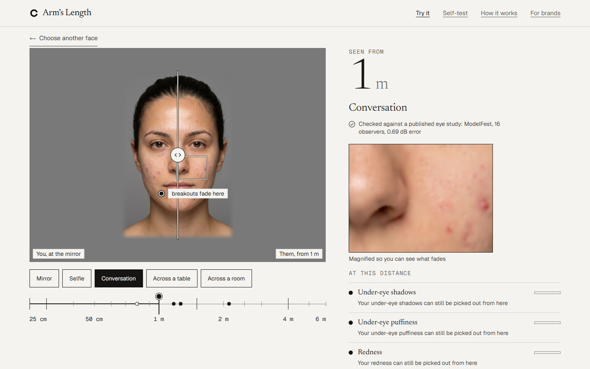
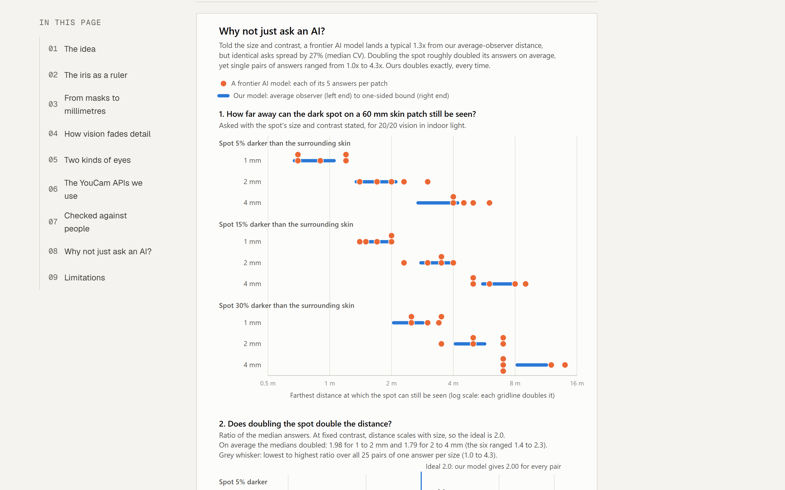

# Arm's Length

**YouCam Skin Analysis finds every pore. Arm's Length shows which ones anyone else can actually see, and from how
far, using a published model of human vision.**

**Live demo and video:** linked from the Devpost submission. **The science, for technical readers:** [`docs/MODEL.md`](docs/MODEL.md) · **Every number:** [`docs/NUMBERS.md`](docs/NUMBERS.md)



You check your skin at mirror range, about 25 cm. Everyone else sees you from a metre or more. Arm's Length takes a
YouCam HD Skin Analysis, measures every mark it found in millimetres and in contrast, and asks a published model of
human vision how far away each one stops being visible. You get distances, not grades:
- "A small share of your pores can be seen from across a table."
- "Most of your dark spots can be seen from across a table."
- A receipt behind every sentence.

Built for Perfect Corp's YouCam API Skin AI & eCommerce VTO Hackathon (Skin AI topic).

## What it does

- **Step back.** Drag a tape from Mirror (25 cm) to Across a room. The photo is re-rendered as an eye would see it from
  there, and each kind of mark shows how much of it is still visible.
- **"How we know" receipts.** For any concern:
  1. where YouCam found the mark;
  2. its size in millimetres, with the iris as the ruler;
  3. its contrast;
  4. the angle it covers at your distance;
  5. the threshold for a typical sharp-eyed person and for even perfect eyes.
- **Worth it?** YouCam Skin Simulation shows a softer version of the same face; we run the *difference* through the
  same vision model. Would anyone notice the change, and from where?
- **The lightest touch.** YouCam Makeup Virtual Try-On renders foundation at several coverage levels, and we measure
  each render to find the lightest coverage that does most of the job.
- **Tomorrow, from their side.** Describe your day ("video standup, client lunch, dinner date"). An agent splits it into
  moments and runs the same vision model for each one through tools, then shows each moment as the person there sees
  you:
  - your face at its true size in their view, in a line-art scene and that light;
  - on a video call, inside the call tile at the stream's resolution, so you can see what the video can't carry;
  - one checked sentence per moment, a held "your mirror" to compare, and what needs no cover all day.

  Every number comes from a tool result; a verifier rejects any other. It uses no YouCam units.
- **Check it with your own eyes.** The walk-back self-test shows a spot at its true size on your screen and predicts
  where it disappears.
- **For brands, a drop-in layer.** `POST /api/visibility` takes any YouCam Skin Analysis result and its photo, and
  returns a distance for every concern as JSON, with no extra YouCam units.
- **Kind by design.**
  - No scores or grades.
  - Deterministic sentence templates; a test blocks any wording on our banned lists (health claims, shaming words).
    The agent's sentences are checked against the same lists before anyone sees them.
  - No photos kept; the session's YouCam tasks are deleted when you leave. A Content-Security-Policy lets pages
    connect only to this server, so the face check runs in your browser and nothing else phones home.

## Headline results

Every number below is generated into [`docs/NUMBERS.md`](docs/NUMBERS.md) from the code and data, and a test fails if
the ledger drifts.

- **The vision model matches human data.** We use Watson & Ahumada's (2005) Standard A model with its published
  constants unchanged. It reproduces the ModelFest observers' thresholds:
  - **0.69 dB RMS** over the 41 test patterns we can generate (16 observers in ten labs);
  - **0.78 dB** over the 8 shaped like skin marks.

  For scale, individual observers sit 3.46 dB RMS from their group's mean. The paper's own 1.03 dB covers all 43
  patterns, two of which can't be generated from parameters, so the two figures aren't like-for-like.
- **Shares, not outliers.** Every concern is summarised as a share at named distances, in two forms:
  - nominal, for a typical sharp-eyed person;
  - a one-sided bound with a 6 dB margin, for "even perfect eyes".

  The farthest single mark would be decided by one outlier. Exact counts live in the receipt.
- **Worth it?** At half strength, the change YouCam Skin Simulation would make to pores is detectable across a table
  for only **4% to 14%** of pores on the four demo faces. The change to under-eye shadows reaches our 10 m cap on every
  face.
- **The lightest touch.** On one face, foundation coverage took the share of pores detectable across a table from 53%
  to 22%, and 75% coverage got most of the way (26%).
- **Better than asking an AI.** We asked a frontier vision model the same questions, five times each: 65 calls, about
  $1.11.
  - Told a spot's size and contrast, its median was 1.33x from ours (geometric mean).
  - Its answers to the same question varied, with the highest of five 1.4x to 2.1x the lowest.
  - Doubling a spot roughly doubled its answers on average, but single pairs ranged from 1.0x to 4.3x.
  - It gave 0.8 m for pores on all four faces, and said "no breakouts" on three faces where YouCam found 18, 5 and 3.

  Ours measures each face and gives the same answer every run. The full method is in
  [`eval/llm-baseline/`](eval/llm-baseline/README.md).



- **Relief you can trust.** We ran the same model with and without our numbers on the four demo faces and six days,
  scored against our model on the scene each one chose:
  - From the photo alone, it called **73%** of the moments where a typical viewer can pick a mark out "not
    noticeable", and said "not on this face" 269 times where YouCam had found the mark.
  - It contradicted our model on **60%** of concern-moments; the agent with our numbers, on 4.2%.
  - **0 of 402** numbers in the agent's plans lacked a tool result behind them.

  Our model is the reference here, so this measures disagreement with the measurement, not with people. The method,
  prompts and raw answers are in [`eval/rehearse/`](eval/rehearse/README.md).

## How it works

```
photo ─► YouCam HD Skin Analysis ─► masks per concern
            │
            ├─► marks: connected components, skeletons for lines; size measured in the photo
            ├─► scale: iris width (MediaPipe Face Landmarker) → mm per pixel (11.71 ± 0.42 mm, Rüfer et al. 2005)
            ├─► contrast: linear light against the surrounding skin; DKL red-green for redness
            └─► Standard A (Watson & Ahumada 2005) + castleCSF colour → threshold → distance per mark
                                                                        │
YouCam Skin Simulation (0.5) ─► the difference, same detector ─► Worth it?
YouCam Makeup Virtual Try-On (foundation coverage) ─► registered renders, same detector ─► the lightest touch
                                                                        │
                                         deterministic sentence templates ─► Step back, cards, receipts

your day ─► agent (Claude Sonnet 5.5, Amazon Bedrock, tool use) ─► moments: scene, light, viewer, call
            │   tools: the same model per moment, call geometry, a free-fix solver, the measured lightest touch
            └─► plan ─► verifier (every number traced to a tool result, banned words) ─► Tomorrow, from their side
```

- **One language model, and it never makes a number.** Everything above the agent line is deterministic code and
  templates. The agent turns your day into moments and words the plan; our tools do the measuring, and a verifier
  checks every number against the tool results before you see it (one repair round, then a plan built directly from
  the results). It reads the measurements as numbers, never the photo.
- **The Step-back picture** uses Peli's band-limited contrast pyramid, so what you see as you drag is the same idea as
  the numbers, not a blur filter.
- **Full model specification:** [`docs/MODEL.md`](docs/MODEL.md). Validation: [`docs/EVAL.md`](docs/EVAL.md). YouCam
  integration notes: [`docs/YOUCAM.md`](docs/YOUCAM.md).

## The YouCam APIs

All are called from the server; keys never reach the browser.

| API | Units | What it does here |
|---|---|---|
| HD Skin Analysis v2.1 | 16 | Finds the marks: eight HD concerns with their masks, which we measure in mm and contrast. |
| Skin Simulation | 4-6 | Drives "Worth it?". It stays pixel-aligned with the photo, so the difference is measured on the same masks. |
| Makeup Virtual Try-On | 1 per render | Drives "the lightest touch": foundation `coverageIntensity`, with `skin_smooth` at 0. |
| Account (credit, history, feature cost) | 0 | Keeps the unit ledger honest: the balance gates every live call. |

**Safe on a budget.**
- The demo faces replay real recorded YouCam output, with no keys needed.
- Live mode on the judging deploy is open while the contest runs: no code needed, within a small daily cap per visitor and a shared daily cap, a balance floor (300 units there; 100 is the minimum anywhere) and a kill switch.
- Out of credits? Anyone can paste their own YouCam API key. It is used only for that tab's calls, sent in a header, never stored or logged, and the project's caps and floor do not apply to it. An access code still works too.
- A task submit is never retried automatically.
- A full live session costs about 26 units.
- Notes for other developers (masks, render offsets, deletion) are in [`docs/YOUCAM.md`](docs/YOUCAM.md).

## Run it locally

Developed on Node 24 (Next.js 16 needs Node 20.9 or later).

```bash
npm ci
npm run dev            # http://localhost:3000. With no .env at all, the demo faces work (recorded YouCam output)
```

For live analysis of your own photo, copy `.env.example` to `.env` and set `YOUCAM_API_KEY` and `LIVE_ACCESS_CODES`.
Every variable is explained in that file. "Tomorrow, from their side" needs `AGENT_ENABLED=1` and Amazon Bedrock
credentials (`CLAUDE_AWS_*`); `AGENT_MODE=replay` serves recorded plans with no model calls. It deploys to Vercel as a standard Next.js app; a public deploy should
start keyless (demo faces only), and anyone can still use their own YouCam API key on it.

**Checks:**

```bash
npm run typecheck && npm test      # unit and property tests (Vitest, fast-check), incl. the numbers drift test
npm run lint
npm run e2e                        # Playwright + axe; builds and serves on port 3100
npx tsx eval/run.ts --detector=standard     # ModelFest replication, about 10 s
npx tsx eval/llm-baseline/run.ts --offline  # the AI comparison, rebuilt from cached replies (no network)
npx tsx eval/rehearse/run.ts --offline      # with and without our numbers, rebuilt from cached replies
npx tsx scripts/docs/numbers.ts --check     # re-measures every number in docs/NUMBERS.md
```

## Repository

```
app/          screens and API routes (app/api/youcam/*, app/api/visibility)
components/   UI
lib/vision/   contrast-sensitivity models, detection, visibility distance, the Step-back renderer
lib/skin/     mask decoding, mark features, contrast, regions
lib/scale/    the iris ruler and its uncertainty
lib/coverage/ the lightest-touch search
lib/rehearse/ the day tools: a scene's visibility, video-call geometry, the free-fix solver
lib/agent/    the day agent: Bedrock tool-use loop, verifier, fallback
lib/copy/     deterministic sentence templates and the banned-word lists
lib/youcam/   server client: upload, tasks, polling, ledger, breaker, replay
eval/         ModelFest replication, the AI comparison, and with-and-without numbers
fixtures/     recorded YouCam responses for the demo faces
docs/         MODEL, EVAL, YOUCAM, DEPLOY, NUMBERS
```

## Limitations

Read [`docs/MODEL.md`](docs/MODEL.md#limitations) before relying on a number. The main ones:
- **The data behind the model.** It is validated against human thresholds for calibrated test patterns, not for skin.
  No human study of skin-mark distances exists yet; the walk-back self-test is a demonstration, not a lab study.
- **The model's simplifications.** It is foveal, static and one mark at a time. Each simplification makes a mark easier
  to see than in life, which is the safe direction for the bound. Phone processing and beauty filters lower contrast,
  which shortens distances, and we can't detect smoothing.
- **Pores and breakouts.** These masks mark a position, so we measure size in the photo or use a prior. Pore distances
  are the least certain, and their confidence is capped.
- **Large soft areas** (under-eye shadows and puffiness, broad redness) get no distance: their size alone makes them
  visible from far on everyone.
- **Worth it? and the lightest touch** rest on single renders per face, at a strength and shade we chose.
- **We measure what the analysis marks**, so its outlines carry through to our numbers.
- **Tomorrow, from their side** rests on stated assumptions: the picture stands for the middle 40° of the viewer's
  view; video calls assume a camera field of view, screen and tile size, and viewing distance (compression would hide
  more); the light levels are presets; Worth it? and the lightest touch are quoted as measured, indoors at 1.5 m.
- **The demo faces are synthetic**, generated for this project and labelled as such.

It measures how visible a mark is, not what it is. If a spot is new, changing or worrying you, ask a doctor or
pharmacist.

## Credits

- **Built with [Claude Code](https://claude.com/claude-code)** as an AI pair-programming assistant.
- **YouCam API** by Perfect Corp: HD Skin Analysis, Skin Simulation, Makeup Virtual Try-On.
- **Claude Sonnet 5.5 on Amazon Bedrock** plans and words "Tomorrow, from their side".
- **Vision science:**
  - Watson & Ahumada (2005), *J. Vision* 5(9):6, and the ModelFest data;
  - Ashraf, Mantiuk, Chapiro & Wuerger (2024), castleCSF;
  - Peli (1990), contrast in complex images;
  - Rüfer, Schröder & Erb (2005), *Cornea* 24(3).

  The full references are in [`docs/MODEL.md`](docs/MODEL.md).
- **Software:** MediaPipe Tasks Vision (Apache 2.0), Next.js, React, Tailwind CSS, sharp; fonts Geist and Newsreader (SIL OFL).
- **Demo faces:** synthetic, generated for this project; no real person's skin is published.

## Licence

[MIT](LICENSE)
