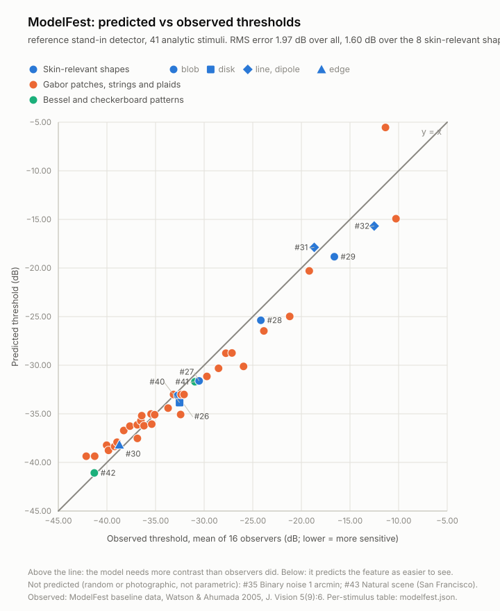
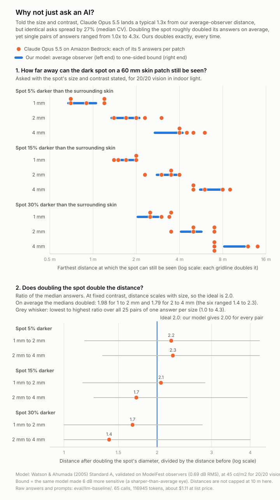

# How we check the model

Arm's Length makes one kind of claim: *beyond this distance, the feature is invisible even to an ideal observer.* This
page shows what backs that claim, in the order a sceptical reader would ask. How the model works is in
[MODEL.md](MODEL.md).

| Question | Answer | Where |
|---|---|---|
| Does the vision model match real people's measurements? | Yes for the shapes we use: 0.69 dB RMS over 41 published test patterns, 0.78 dB over the 8 that look like skin features | [1](#1-modelfest-human-data) |
| Does the measuring stage recover the size and contrast of a feature? | Yes on planted features: sizes within 2% (a wrinkle's length within 5%), contrasts within 0.002 | [2](#2-synthetic-skin-oracles) |
| Do the numbers behave sensibly? | Distances grow with size, contrast and margin; the lookup tables match direct computation | [3](#3-properties-the-tests-enforce) |
| What does it say for typical features? | Table of nominal and bound distances | [4](#4-illustrative-distances) |
| Can I check one prediction myself? | The walk-back self-test | [5](#5-check-one-prediction-yourself) |
| Is it better than asking an AI? | Claude Opus 5.5 is good at the general recipe (about 1.3x from our value when told size and contrast), but it gives a different number each time, breaks the size law and does not measure the face | [6](#6-why-not-just-ask-an-ai) |
| What would an improvement be worth? | Per face and concern: a simulated change to pores is small for a typical viewer; a large soft area shows even a small change from far | [7](#7-what-would-an-improvement-change-worth-it) |
| How much makeup is enough? | The knee of the foundation coverage curve, checked on renders | [8](#8-the-lightest-touch-on-the-recorded-renders) |

**What is not validated yet:** there is no human study of distances for real skin features (ModelFest used calibrated
test patterns on a display), the demo faces are synthetic, YouCam's repeatability on the same photo has not been
measured, the AI comparison has no ground truth on real faces, and the Skin Simulation behind "Worth it?" is YouCam's
rendering, which we cannot inspect. [MODEL.md](MODEL.md#limitations) lists the limits of the claim.

## 1. ModelFest: human data

### What it is

ModelFest is a public data set from a consortium of vision laboratories. Sixteen observers in ten labs were shown 43
test patterns, each faded until it was only just visible, and the contrast at that point (the *threshold*) was recorded.
It exists so that models of human vision can be tested against the same measurements. Its patterns include the shapes
that matter to us: soft Gaussian blobs (pores and small spots), a uniform disk (a spot), a very thin line and a narrow
pair of lines (wrinkles), and an edge (the border of a region). Watson & Ahumada (2005) fitted the *standard model* that
we use to these 43 thresholds. Their constants are the ones we ship.

### How we run it

`eval/modelfest/` generates each pattern from its published definition at unit contrast (no image files are needed),
asks the same detector code that powers the app for the contrast at which it just detects the pattern (bisection on
contrast), and compares that with the observers' mean threshold. Thresholds are in dB, `20 log10(contrast)`; **error =
predicted - observed**, so a positive error means the model needs more contrast than the observers did (it under-predicts
visibility). Nothing is tuned on this data: the model's constants are the paper's.

### Results

Standard A, ModelFest's own lighting (30 cd/m^2), no safety margin:

- **RMS error 0.69 dB over the 41 patterns we can generate.**
- **RMS error 0.78 dB over the 8 skin-relevant shapes** (four Gaussian blobs, the disk, the line, the dipole, the edge).
- For scale: individual observers differ from the observer mean by 3.46 dB RMS, and the most sensitive of the 16 sits
  4.2 dB below it. An error of under 1 dB against the mean is well inside the difference between people.

<!-- generated:modelfest-families:start -->

| Family | Stimuli (#) | n | RMS error (dB) | Bias (dB) | Largest error (dB) |
| --- | --- | --- | --- | --- | --- |
| Gaussian blobs (pores, small spots) | 26-29 | 4 | 0.18 | +0.02 | +0.31 (#29) |
| Disk (a spot) | 40 | 1 | 0.45 | -0.45 | -0.45 (#40) |
| Thin line and dipole (wrinkles) | 31-32 | 2 | 1.45 | +0.66 | +1.95 (#31) |
| Edge (border of a region) | 30 | 1 | 0.57 | +0.57 | +0.57 (#30) |
| Gabor patches: fixed size, fixed cycles, oriented | 1-14, 36-37 | 16 | 0.63 | +0.26 | +1.63 (#4) |
| Elongated Gabors and baguettes | 15-21 | 7 | 0.62 | +0.41 | +1.10 (#15) |
| Compound Gabors, collinear strings, plaids | 22-25, 33-34, 38-39 | 8 | 0.76 | 0.00 | -1.39 (#38) |
| Bessel and checkerboard patterns | 41-42 | 2 | 0.70 | -0.70 | -0.78 (#41) |
| **All analytic stimuli** | 1-34, 36-42 | 41 | 0.69 | +0.17 | +1.95 (#31) |
| **Skin-relevant shapes only** | 26-32, 40 | 8 | 0.78 | +0.19 | +1.95 (#31) |

<!-- generated:modelfest-families:end -->

The eight skin-relevant shapes, one by one:

<!-- generated:modelfest-skin:start -->

| # | Stimulus | Looks like | Observed (dB) | Predicted (dB) | Error (dB) |
| --- | --- | --- | --- | --- | --- |
| 26 | Gaussian sd 30 arcmin | a broad soft patch (dark circle scale) | -32.73 | -32.86 | -0.13 |
| 27 | Gaussian sd 8.43 arcmin | a soft spot | -30.52 | -30.63 | -0.11 |
| 28 | Gaussian sd 2.106 arcmin | a small spot | -24.17 | -24.15 | +0.02 |
| 29 | Gaussian sd 1.05 arcmin | a pore or the smallest spot | -16.61 | -16.30 | +0.31 |
| 30 | Edge x Gaussian | the border of a region | -38.72 | -38.15 | +0.57 |
| 31 | Line 0.5 arcmin x Gaussian | a fine wrinkle | -18.68 | -16.73 | +1.95 |
| 32 | Dipole 3 px x Gaussian | a wrinkle with a highlight beside it | -12.51 | -13.14 | -0.63 |
| 40 | Disk 0.25 deg diameter | an age spot or freckle | -32.53 | -32.98 | -0.45 |

<!-- generated:modelfest-skin:end -->



*Each point is one test pattern. The horizontal position is what the observers needed; the vertical position is what the
model predicts. On the diagonal is a perfect prediction; above it the model needs more contrast than people did. The data
behind every point is in `eval/results/modelfest.json`.*

**Where it is least accurate.** The skin-relevant shape the model under-predicts most is the thinnest line (#31, +1.95
dB): real observers were somewhat better at spotting a hairline than the model. That is the direction that would make a
distance too short, and it is why the safety margin (6 dB) is larger than any single error here. The largest errors elsewhere
are a 4 cycles/deg Gabor (+1.63 dB) and a plaid (-1.39 dB).

### Comparison with the paper, and why our set is 41

| | Stimuli | RMS error |
|---|---|---|
| Watson & Ahumada 2005, Standard A (paper, Table 5) | 43 | 1.03 dB |
| This repository, Standard A, all analytic patterns | 41 | 0.69 dB |
| This repository, the 8 skin-relevant shapes | 8 | 0.78 dB |
| This repository's 41 plus the two excluded patterns, at the errors measured with the original images | 43 | 1.03 dB |

The paper's 1.03 dB covers all 43 patterns. We can regenerate 41 of them, because two are not defined by a formula:

| # | Pattern | Why we cannot regenerate it | Model error on the original images |
|---|---|---|---|
| 35 | Binary noise, 1 arcmin samples | One particular random draw | -4.22 dB |
| 43 | Natural scene (a photograph of a city) | A photograph | -2.93 dB |

To use them we would have to ship the stimulus images, and the data set states no licence, so we ship only our own table
of 43 observer means. The errors in the last column come from a separate replication on the original images, run outside
this repository. Putting them back reproduces the paper:
`sqrt((41 x 0.688^2 + 4.22^2 + 2.93^2) / 43) = 1.03 dB`. So the 0.69 dB is *not* a better model than the paper's; it is the
same model scored without its two hardest cases.

**Which way do the excluded errors point?** Both are negative: the model says noise and a busy natural scene are *easier*
to see than observers found them. For a claim of the form "invisible beyond d" that is the cautious direction (the model
over-states how far they carry), and textured skin is plausibly closer to noise and a natural scene than to clean blobs.
Among the skin-relevant shapes the model under-predicts visibility by at most 1.95 dB (the thin line), and the 6 dB
margin covers that.

### Data provenance

- `eval/modelfest/thresholds.json` holds 43 observer means (and the spread across observers) derived from the
  ModelFest baseline data (16 observers x 43 stimuli x 4 repeats). The source file is identified by its SHA-256 in that
  file. The values in the file are log sensitivity; the table above is in dB (`-20 x value`).
- Where the paper's Table 1 and the released images disagree, we followed the images (for example, Table 1 prints a Gabor
  envelope of 0.05 deg where the images and the consortium's own table give 0.5 deg). The differences are listed at the top
  of `eval/modelfest/stimuli.ts` and were checked pixel by pixel with `scripts/eval/check-stimuli.ts` against a local copy.
- The harness also contains a *stand-in* detector with a cruder sensitivity curve that was tuned on these same thresholds
  (about 2 dB RMS). It exists so the harness runs without the model; its numbers are not validation, and the default
  command uses it. Always pass `--detector=standard`.

## 2. Synthetic skin oracles

An oracle is a case where we know the right answer because we drew it. We build a skin-coloured photo (about 1%
pixel noise) and a YouCam-style mask with planted features of known size and contrast, run the real measuring code
(`measureAnalysis`), and check that it recovers what we planted. The scale is 0.2 mm per pixel. Sizes are in
millimetres, contrasts are Weber contrast in linear light.

| Case | Planted | Recovered at the time of writing | The test requires |
|---|---|---|---|
| Age spot (outline drawn with a darker neighbour inside its ring) | 4.0 mm, contrast -0.25 | 4.02 mm, -0.250 | within 0.2 mm and 0.03 |
| The neighbouring darker spot | 2.8 mm, -0.60 | 2.75 mm, -0.600 | within 0.2 mm and 0.04 |
| Wrinkle (mask drawn 2 px off the crease) | 16 mm long, 0.6 mm wide, -0.30 | 15.2 mm, 0.602 mm, -0.301 | length 94-103% of planted, width within 0.15 mm, contrast within 0.05 |
| Pore marker (5 px dot) | 1.0 mm, -0.40 | 0.998 mm, -0.402 | within 0.3 mm and 0.05; size source "photo" |
| Pore marker on flat skin | nothing | prior of 0.4 mm, flagged "prior" | prior, at least 0.3 mm |
| Acne marker (red lesion) | red-green 0.1380, luminance -0.1721, from the colour maths | 0.1380, -0.1721 | within 0.03 and 0.04 |
| Dark circle (80 x 40 px region) | 16 x 8 mm, -0.30 against the cheek band | 16.0 x 8.0 mm, -0.2997 | exact size, contrast within 0.02 |
| Redness zone | red-green 0.0850, luminance -0.0743 | 0.0850, -0.0743 | within 0.02 and 0.03; reference "skin outside zones" |

The wrinkle's length comes out about 5% short (the skeleton loses a pixel or two at each end); the line threshold depends
only weakly on length, and the tolerance is written into the test. An empty redness mask is reported as skipped ("no
redness zones were found"), not as a zero.

Other checks of the measuring stage (`lib/skin`, `lib/scale`):

- **Mask decoding.** A mask with a baked dark layer at alpha 51, a drawn outline and a transparent interior gives one
  component by the modal-alpha rule (where "alpha above 0" would give the whole frame); a single-alpha mask has no
  foreground. Holes fill up to a cap; components are 8-connected; a plain 80 x 3 px stroke has a skeleton length within
  94-102% of 80 and a distance-transform width of exactly 3 px.
- **Colour maths.** sRGB code 128 decodes to 0.2158605 (IEC 61966-2-1); white maps to equal cone signals, so neutral greys
  have zero red-green contrast; a redder patch has positive red-green contrast and a swapped pair has the opposite sign.
- **Scale.** The iris ruler gives `11.71 / iris px`; its uncertainty is the population spread and the landmark error in
  quadrature (3.7% for a 100 px iris), larger for a small iris or one eye; a card held flat is recovered at any rotation
  with under 1% uncertainty, a tilted card widens it, a non-card shape is rejected, and the card is at least four times
  more certain than the iris. The committed demo-face scales satisfy `mm/px x iris px = 11.71` and a plausible
  interpupillary distance.
- **Recorded analyses.** Real YouCam output for the two synthetic demo faces replays offline (the tests never call the
  live API; the ranges are in `lib/skin/fixtures.test.ts`). On the deep-skin face: 80-100 age spots (YouCam drew 89), 10-25 acne markers (15), at least 190 pores
  (201 dots), 120-229 wrinkle lines, two dark circles, two eye bags, and the empty redness mask is skipped. On the other
  face: 180-205 age spots (194), 5-12 acne markers (7), at least 170 pores (184) and two or more redness zones, all with
  positive red-green contrast. Every contrast is finite and every size positive.

## 3. Properties the tests enforce

Only where a silent bug would break the claim (`npm test` runs all of them):

- **Reproducing the published model.** The five analytic ModelFest patterns (#26-29 and #40) agree with an independent
  numpy implementation to 0.1 dB, both computed directly and through the lookup tables; the CSF peaks are 217.3 at 3.45
  cycles/deg (Standard A) and 289.0 at 3.62 (B), as published; the image-domain FFT route agrees with the closed-form route.
- **The tables are the model.** Lookups equal direct computation off the grid (0.05 dB for blobs, 0.1 dB for lines), thresholds
  never fall as a feature gets smaller, and a finite line converges to the infinite line.
- **Distances behave.** A distance does not decrease with size, contrast or margin (checked at several points each); at fixed contrast it scales exactly with
  size (2.5 times the size gives 2.5 times the distance); the bound is never below the nominal distance; a dim room shortens
  the nominal distance but not the bound; a red-green contrast never shortens a distance; non-chromatic concerns ignore it.
- **The detector and the numbers agree.** The detector's response is 1 at the nominal distance of a 3 mm, 12% disk
  (3.234 m), ignores the margin, and falls with distance.
- **castleCSF port.** Rows of castleCSF's own data files equal a reference port to 1e-4 in log10 and lie within 4 dB (Gabors)
  and 3.5 dB (discs) of the measurements; the disc rule is continuous at 0.083 deg and falls as `r^2` below it.
- **The picture.** The renderer returns an image of the same size with alpha kept, is deterministic, is almost the identity
  at 10 cm, removes fine detail with distance while keeping a large soft patch, and renders a 512 px photo in under a second.
- **The docs.** The parameter tables in MODEL.md and the tables in this file are regenerated by script and compared with the
  code in `lib/vision/params.doc.test.ts`; the copy linter checks both pages for banned words.

## 4. Illustrative distances

Each row is a feature we plant and ask the model about, with luminance contrast only. "Nominal" is the distance for an
average observer; "bound" adds the 6 dB margin. Both columns are at ModelFest's 30 cd/m^2, where the luminance factor is exactly
1, so the numbers come from Standard A and nothing else. The last column is what the app reports at its default indoor
setting (45 cd/m^2, capped at 10 m).

<!-- generated:distances:start -->

| Feature | Shape and size | Contrast | Nominal (average observer) | Bound (+6 dB) | Bound in the app (indoor, 45 cd/m^2) |
| --- | --- | --- | --- | --- | --- |
| Age spot | 3 mm disk | 12% | 3.2 m | 4.8 m | 5.3 m |
| Pore, sharp and strong | Gaussian, sd 0.12 mm (0.28 mm wide) | 30% | 0.60 m | 0.88 m | 0.96 m |
| Pore, as a phone photo usually measures it | Gaussian, 0.3 mm wide | 5% | 0.17 m | 0.31 m | 0.35 m |
| Spot | 4 mm disk | 10% | 3.8 m | 5.8 m | 6.4 m |
| Freckle | 2 mm disk | 15% | 2.5 m | 3.7 m | 4.0 m |
| Papule | 5 mm disk | 15% | 6.2 m | 9.1 m | 10+ m |
| Under-eye shadow (a large soft area) | 35 mm soft-edged disk | 3% | 11.5 m | 22.9 m | 10+ m |

<!-- generated:distances:end -->

Reading it: a 3 mm spot of 12% contrast is just visible to an average observer at 3.2 m, and not at all beyond 4.8 m even
for a sharp one. A pore as a phone photo usually measures it (0.3 mm wide, diluted to 5% contrast) is out of reach of
anyone but a very close viewer: its bound is about the length of a selfie. A sharp, strong pore (30% contrast) carries to
just under 1 m. The same rules produce the nominal and bound values the app shows, and the Step-back picture applies the
same thresholds.

The last row is a large soft area, such as an under-eye shadow: even at 3% contrast it carries 11.5 m for an average
observer and 22.9 m for the bound at 30 cd/m^2. That is why we do not lead with a distance for these (MODEL.md,
section 9).

## 5. Check one prediction yourself

The walk-back self-test (`lib/selftest`) turns the model into something anyone can try. Hold a bank card against the
screen to calibrate millimetres per pixel; the screen then draws a disk of a chosen size and Weber contrast on a mid-grey
background (a gamma of 2.2 is assumed); the model predicts the distance at which it should vanish, nominal and bound,
for an assumed screen luminance of 100 cd/m^2; then you walk back until it disappears and the result is compared with the band.

How to read it: vanishing *before* the nominal distance is normal for a real viewer in a real room, because the bound is
one-sided. Vanishing between nominal and bound fits the model. Still seeing the disk *beyond* the bound would contradict
the model (or the screen assumptions) and is reported as such, not hidden. It is a demonstration, not a lab study: the
screen's true luminance is unknown.

## 6. Why not just ask an AI?

A general-purpose vision language model gives a sensible generic answer to "from how far can people see this?" Is that a
substitute for measuring? We ran the head-to-head: **Claude Opus 5.5 via Amazon Bedrock** (`global.anthropic.claude-opus-5-5`,
Converse API) against the visibility model, in 65 real calls. Everything here comes from `eval/llm-baseline/`: the prompts
(`prompts.md`), every raw reply (`results/raw/`), `results/summary.json` and the chart. The tables below are generated from
that file.



**The short version.** The AI is good at the general recipe, and we did not expect that. When we told it a spot's size and
contrast, its median answer for each patch landed a typical **1.3x** from our average-observer distance. "An LLM gives
nonsense" is not what we found. What it cannot do is what the product does: **measure the inputs on each face** (size,
contrast and location, from the photo and YouCam's masks), **give the same answer every time**, and **scale lawfully**
(a spot twice as wide is visible from twice as far).

### Setup

- 65 calls: 20 for Test A and 45 for Test B, with no retries. Each call is independent: one user message with one image and
  one text block, no history. `maxTokens` was 4000 and nothing else was set (this model takes no sampling or thinking
  parameters). The reply is JSON in plain text, parsed leniently.
- **Cost:** 76,790 input and 40,155 output tokens, about **$1.11** at the list price we assumed ($4 per million input
  tokens and $20 per million output tokens; Bedrock billing may differ). Test A cost $0.34 and Test B $0.77. No YouCam
  units were used.

### Test A: the four recorded faces (20 calls)

The four demo photos (synthetic faces), five independent asks each, with the interpupillary distance given as about 63 mm.
The question asks for the **farthest** distance at which each concern could still be seen, so the matching number of ours
is the bound of the farthest target. We also show how many of the face's targets are still in view at 1.5 m. "10+" is our
10 m cap. Fine lines and redness are left out of this table: in the committed run our numbers for them were measured
against a Skin Simulation, a basis we withdrew (MODEL.md, section 3), while the four concerns below do not depend on it.

<!-- generated:llm-faces:start -->

| Face | Concern | Claude: median (min to max), m | Run-to-run CV | Ours: farthest, bound (m) | Ours: in view at 1.5 m |
| --- | --- | --- | --- | --- | --- |
| p1a | Pores | 0.8 (0.6 to 1) | 22% | 4.1 | 150 of 450 |
| p2b | Pores | 0.8 (0.6 to 1) | 25% | 4.2 | 342 of 649 |
| p3a | Pores | 0.8 (0.6 to 1) | 22% | 3.1 | 81 of 221 |
| p5a | Pores | 0.8 (0.6 to 0.8) | 15% | 3.1 | 55 of 250 |
| p1a | Dark spots | 1.5 (1 to 1.5) | 17% | 10+ | 62 of 64 |
| p2b | Dark spots | 4 (3.5 to 4) | 7% | 10+ | 88 of 89 |
| p3a | Dark spots | 6 (5 to 6) | 8% | 10+ | 187 of 194 |
| p5a | Dark spots | 2.5 (2.5 to 3) | 10% | 7.1 | 50 of 53 |
| p1a | Breakouts | 3 (3 to 4) | 14% | 9.1 | 24 of 40 |
| p2b | Breakouts | null in 5 of 5 runs | - | 5.1 | 13 of 18 |
| p3a | Breakouts | null in 5 of 5 runs | - | 3.2 | 5 of 5 |
| p5a | Breakouts | null in 5 of 5 runs | - | 2.5 | 3 of 3 |
| p1a | Under-eye shadows | 4 (3 to 5) | 20% | 10+ | 2 of 2 |
| p2b | Under-eye shadows | 6 (5 to 7) | 12% | 10+ | 2 of 2 |
| p3a | Under-eye shadows | 3.5 (3 to 3.5) | 7% | 10+ | 3 of 3 |
| p5a | Under-eye shadows | 4 (3 to 5) | 18% | 10+ | 2 of 2 |

<!-- generated:llm-faces:end -->

- **Consistency is better than we expected, and still not zero.** Over the 19 of 24 face-and-concern cells in which Claude
  gave several numbers (including the two concerns not shown), the median run-to-run spread (CV) is 15% and the highest answer is a median 1.4x the lowest (worst 1.7x). One cell flips on
  whether the concern exists at all: p1a fine lines was a number in 3 runs and null in 2.
- **The numbers barely move with the face.** Pores are 0.8 m on every face. The share of pores in view at 1.5 m, by our
  count, is 33%, 53%, 37% and 22% (p1a, p2b, p3a, p5a).
- **Breakouts were null on three faces** where YouCam found 18, 5 and 3 of them (visible from at most 5.1, 3.2 and 2.5 m by
  our bound). Claude is looking at pixels with no mask to guide it.
- **Where they agree.** On p2b and p5a Claude answered "null" for redness in all five runs, and YouCam's redness mask is
  empty on both faces. For under-eye shadows Claude says 3.5 to 6 m and ours is at the 10 m cap, which is expected for a
  large soft area (MODEL.md, section 9).
- **What it cannot return** is the thing the product shows: *which* marks, *where*, and *how many* at a given distance.
  It gives one number per concern.
- **Ours is identical on every run.** Computing the four faces twice in one process gives byte-identical results
  (SHA-256 `528cec5a...` in `summary.json`). The model has no randomness: the same photo gives the same numbers.
- **These are not contradictions in every case.** Our farthest-target number is a deliberately generous one-sided bound.
  A lower answer can be right for a typical viewer. There is no ground truth for these faces, so Test A measures
  consistency and sensitivity to the individual face, not who is right.

### Test B: nine synthetic patches (45 calls)

Nine 60 x 60 mm patches at 10 px/mm: a uniform skin tone (sRGB 208, 154, 124), a centred dark disk of 1, 2 or 4 mm and a
Weber contrast of 5%, 15% or 30% in linear light, and a printed millimetre ruler along the bottom edge. Claude was **told
the size and the contrast in words**, everything our model knows, five asks per patch.

**Reference.** The Watson & Ahumada (2005) Standard A model, validated against ModelFest observers in section 1 (0.69 dB
RMS over 41 stimuli), through `lib/vision` at the default indoor light (45 cd/m^2, 20/20). "Average observer" is margin
0 and the bound is 6 dB. Two caveats: this is a model of human vision validated on lab patterns, not a measurement of
people looking at these patches; and the step from ModelFest's 30 cd/m^2 to 45 cd/m^2 is an unverified heuristic
(MODEL.md, limitation 6). The distances here are not capped at 10 m.

<!-- generated:llm-patches:start -->

| Spot | Our model: average observer to bound (m) | Claude: median (min to max), m | CV | Median over average-observer value | Answers inside our range |
| --- | --- | --- | --- | --- | --- |
| 1 mm, 5% | 0.66 to 1.1 | 0.9 (0.7 to 1.2) | 27% | 1.36x | 3 of 5 |
| 2 mm, 5% | 1.3 to 2.1 | 2 (1.4 to 3) | 30% | 1.51x | 3 of 5 |
| 4 mm, 5% | 2.6 to 4.3 | 4.5 (4 to 6) | 18% | 1.70x | 2 of 5 |
| 1 mm, 15% | 1.4 to 2 | 1.7 (1.4 to 2) | 16% | 1.25x | 5 of 5 |
| 2 mm, 15% | 2.7 to 4 | 3.5 (2.3 to 4) | 20% | 1.28x | 4 of 5 |
| 4 mm, 15% | 5.5 to 8 | 6 (5 to 9) | 28% | 1.10x | 2 of 5 |
| 1 mm, 30% | 2 to 2.9 | 3 (2.5 to 3.5) | 16% | 1.49x | 2 of 5 |
| 2 mm, 30% | 4 to 5.8 | 5 (3.5 to 7) | 27% | 1.24x | 2 of 5 |
| 4 mm, 30% | 8 to 12 | 7 (7 to 14) | 36% | 0.87x | 0 of 5 |

<!-- generated:llm-patches:end -->

- **Error factor.** Taking the median answer per patch, Claude is off the average-observer distance by a geometric mean of
  **1.33x** (worst 1.70x, at 4 mm and 5%). Counting all 45 answers it is 1.39x. Eight of the nine medians are above the
  average-observer value, so it leans toward "visible from farther". By the medians this is a decent estimate.
- **In range.** **23 of 45 answers (51%)** fall between our average-observer distance and our bound; the other 22 miss it by
  up to 1.4x. By any single ask, being inside the range is a coin flip.
- **Run-to-run spread.** Five identical asks about one patch differ by 16% to 36% (CV, median 27%), and the highest of the
  five is 1.4x to 2.1x the lowest. That spread is as wide as our whole average-observer-to-bound band (1.4x to 1.6x).
  Ours has zero spread.

**The size law.** Visibility depends only on the angle a feature subtends, so at a fixed contrast the farthest distance
must double when the spot doubles. Our model gives exactly 2.0 for every doubling by construction (a test checks it).
Claude's ratio of medians, against that ideal of 2.0:

<!-- generated:llm-scaling:start -->

| Contrast | Doubling | Our model | Claude: ratio of medians | Claude: lowest to highest over 25 answer pairs |
| --- | --- | --- | --- | --- |
| 5% | 1 to 2 mm | 2.0 | 2.22 | 1.17 to 4.29 |
| 5% | 2 to 4 mm | 2.0 | 2.25 | 1.33 to 4.29 |
| 15% | 1 to 2 mm | 2.0 | 2.06 | 1.15 to 2.86 |
| 15% | 2 to 4 mm | 2.0 | 1.71 | 1.25 to 3.91 |
| 30% | 1 to 2 mm | 2.0 | 1.67 | 1.00 to 2.80 |
| 30% | 2 to 4 mm | 2.0 | 1.40 | 1.00 to 4.00 |

<!-- generated:llm-scaling:end -->

Averaged over the three contrasts, the ratio of medians is 1.98 for 1 to 2 mm and 1.79 for 2 to 4 mm, so the *average* is
not far from 2. It is not stable: a single pair of answers can give anything from 1.0x to 4.3x, and at 30% contrast the
medians rise by only 1.7x and 1.4x.

**Why.** Claude's own short reasoning (stored in each raw reply) states the right recipe: a spot is visible when it subtends
at least some threshold angle for its contrast, so the distance is size divided by that angle (28 of the 45 replies cite
Ricco's law, 31 cite Blackwell thresholds, and 44 give an angle in arcminutes). A single threshold angle per contrast would
give exact doubling. But the angle is recalled afresh each time: for the 4 mm, 30% spot it used about 2 arcmin in one ask
(answer 7 m) and about 1.15 arcmin in another (12 m). That is the spread, and it is where the law breaks.

### What this does and does not show

- **Fairly put:** the AI knows the general recipe and, told the size and contrast, lands within about 1.3x. Our advantage is
  not a better formula. It is that we **measure the inputs per face** (size in millimetres, contrast in linear light, where
  each mark is), are **deterministic**, and **scale physically lawfully**. Those are what let the app say "most of your
  pores are out of sight across a table" and open a chain of receipts, with the exact counts, for each number.
- **One model, one prompt wording, five asks per item.** A different prompt, or the median of many asks, would shrink the
  noise by roughly the square root of the number of asks. That costs N calls per number and still gives no per-feature
  counts. We did not try it.
- **Test B is the AI's best case:** an isolated disk, size and contrast supplied, one concern. It still misses our range on
  half its answers.
- **Not shown:** that the AI is wrong on real faces. There is no ground truth for them. The self-test (section 5) is how our
  numbers get checked, not this comparison.
- **Our side is a model too.** The claim is a one-sided bound, validated on ModelFest, not a prediction for any one person.
- The AI's general advice ("pores usually are not visible at conversation distance") is often sensible, and fine to read.
  It is not a per-face, per-feature measurement.

## 7. What would an improvement change? (Worth it)

For each face and concern: the distance at which the *difference* between the photo and YouCam's Skin Simulation at
**half strength** stays detectable, through the same detector and the same 6 dB margin (how it is computed: MODEL.md,
section 10). The table is generated by `scripts/docs/product-tables.ts`, which runs `worthIt` on the recorded simulations
(`sim_improve_a05` for lines, under-eye shadows, puffiness and redness; `sim_improve_b05` for pores, dark spots and
breakouts). Every count is "at most": a ceiling for an ideal observer looking straight at the mark. "10+" is the 10 m cap.
Concerns YouCam found nothing for (redness on p2b and p5a) have no row.

<!-- generated:worthit:start -->

| Face | Concern | Found | Farthest change (m) | At most, at 1 m | at 1.5 m | at 2.5 m | at 4 m |
| --- | --- | --- | --- | --- | --- | --- | --- |
| p1a | Pores | 450 | 3.2 | 129 (29%) | 38 (8%) | 4 (1%) | 0 (0%) |
| p1a | Dark spots | 64 | 9.8 | 47 (73%) | 38 (59%) | 22 (34%) | 8 (13%) |
| p1a | Breakouts | 40 | 8.3 | 24 (60%) | 13 (33%) | 7 (18%) | 5 (13%) |
| p1a | Fine lines | 93 | 10+ | 77 (83%) | 66 (71%) | 36 (39%) | 19 (20%) |
| p1a | Under-eye shadows | 2 | 10+ | 2 (100%) | 2 (100%) | 2 (100%) | 2 (100%) |
| p1a | Under-eye puffiness | 2 | 10+ | 2 (100%) | 2 (100%) | 2 (100%) | 2 (100%) |
| p1a | Redness | 5 | 2.1 | 1 (20%) | 1 (20%) | 0 (0%) | 0 (0%) |
| p2b | Pores | 649 | 2.6 | 230 (35%) | 91 (14%) | 1 (0%) | 0 (0%) |
| p2b | Dark spots | 89 | 10+ | 60 (67%) | 55 (62%) | 31 (35%) | 14 (16%) |
| p2b | Breakouts | 18 | 4.2 | 12 (67%) | 4 (22%) | 1 (6%) | 1 (6%) |
| p2b | Fine lines | 188 | 10+ | 159 (85%) | 142 (76%) | 101 (54%) | 50 (27%) |
| p2b | Under-eye shadows | 2 | 10+ | 2 (100%) | 2 (100%) | 2 (100%) | 2 (100%) |
| p2b | Under-eye puffiness | 2 | 10+ | 2 (100%) | 2 (100%) | 2 (100%) | 2 (100%) |
| p3a | Pores | 221 | 2.7 | 67 (30%) | 25 (11%) | 1 (0%) | 0 (0%) |
| p3a | Dark spots | 194 | 6.9 | 136 (70%) | 92 (47%) | 33 (17%) | 8 (4%) |
| p3a | Breakouts | 5 | 2.4 | 5 (100%) | 3 (60%) | 0 (0%) | 0 (0%) |
| p3a | Fine lines | 207 | 10+ | 175 (85%) | 148 (71%) | 91 (44%) | 41 (20%) |
| p3a | Under-eye shadows | 3 | 10+ | 3 (100%) | 3 (100%) | 3 (100%) | 3 (100%) |
| p3a | Under-eye puffiness | 2 | 10+ | 2 (100%) | 2 (100%) | 2 (100%) | 2 (100%) |
| p3a | Redness | 4 | 10+ | 2 (50%) | 2 (50%) | 2 (50%) | 2 (50%) |
| p5a | Pores | 250 | 2.6 | 42 (17%) | 11 (4%) | 1 (0%) | 0 (0%) |
| p5a | Dark spots | 53 | 4.1 | 22 (42%) | 13 (25%) | 6 (11%) | 1 (2%) |
| p5a | Breakouts | 3 | 2.1 | 3 (100%) | 1 (33%) | 0 (0%) | 0 (0%) |
| p5a | Fine lines | 107 | 7.9 | 82 (77%) | 63 (59%) | 28 (26%) | 6 (6%) |
| p5a | Under-eye shadows | 2 | 10+ | 2 (100%) | 2 (100%) | 2 (100%) | 2 (100%) |
| p5a | Under-eye puffiness | 2 | 10+ | 2 (100%) | 2 (100%) | 2 (100%) | 2 (100%) |

<!-- generated:worthit:end -->

- **Pores: a small change.** A half-strength change to pores is detectable beyond 4 m on none of the four faces, on at most
  4% to 14% of their pores across a table (1.5 m), and the farthest single pore reaches only 2.6 to 3.2 m.
- **Dark spots, lines and breakouts are in between,** and depend on the face: at 4 m, at most 2% to 16% of dark spots, 6% to
  27% of lines and 0 to 13% of breakouts could show a change.
- **Under-eye shadows and puffiness: across a room.** The change is detectable at the 10 m cap on every recorded face. This
  is the large-soft-area effect (MODEL.md, section 9): a small change over a large area reaches far. It says the area is
  large, not that anyone would notice.
- **What it is for.** It separates a change in the picture that a viewer could tell apart from one they could not. A
  simulated softening of pores would not change what a typical person across the table sees; a simulated lightening of
  under-eye shadows could. It says nothing about what any product or routine would do.

## 8. The lightest touch on the recorded renders

The least-coverage search (MODEL.md, section 11) run on the recorded foundation grid at 1.5 m, replayed from the fixtures
(no live calls). Each cell is the share of the concern's marks still detectable at 1.5 m, by our bound, after that render.
The search renders 50 first, then 75 and 100, and 25 only when 50 already reaches the knee, so no cell is shown for 25.
"Least coverage" is the knee: the lowest coverage that achieves at least 80% of the reduction full coverage achieves. A
small concern moves in big steps (p3a has 5 breakout markers, so steps of 20%). Dark circles and eye bags have no makeup
lever.

<!-- generated:least-makeup:start -->

| Face | Concern | Found | No makeup | Coverage 50 | 75 | 100 | Least coverage |
| --- | --- | --- | --- | --- | --- | --- | --- |
| p1a | Dark spots | 64 | 97% | 83% | 69% | 56% | 100 (knee) |
| p1a | Pores | 450 | 33% | 21% | 17% | 12% | 100 (knee) |
| p1a | Breakouts | 40 | 60% | 38% | 30% | 30% | 75 (knee) |
| p2b | Dark spots | 89 | 99% | 93% | 89% | 84% | 100 (knee) |
| p2b | Pores | 649 | 53% | 33% | 26% | 22% | 75 (knee) |
| p2b | Breakouts | 18 | 72% | 44% | 33% | 28% | 75 (knee) |
| p3a | Dark spots | 194 | 96% | 92% | 82% | 71% | 100 (knee) |
| p3a | Pores | 221 | 37% | 27% | 24% | 21% | 100 (knee) |
| p3a | Breakouts | 5 | 100% | 100% | 40% | 20% | 100 (knee) |

<!-- generated:least-makeup:end -->

- **No concern reached "at most 10% detectable across a table" at any coverage,** so every row reports a knee, not a
  guarantee of hiding.
- **Foundation does most for pores and breakouts,** and least for dark spots: pores fall from 33%, 53% and 37% to 12%, 22%
  and 21% at full coverage, while dark spots fall from 97%, 99% and 96% to 56%, 84% and 71%.
- The foundation lever was measured on one face in the spike (spot contrast -30% at coverage 50 and -45% at 100;
  [YOUCAM.md](YOUCAM.md#4-integration-notes-we-learned-the-hard-way), note 5), and the grid uses one cheek-matched shade per face.

## 9. Reproduce

```bash
npm ci
npx tsx eval/run.ts --detector=standard     # about 10 s; rewrites eval/results/modelfest.json and modelfest.svg
npm test                                    # all the checks above, offline (recorded YouCam responses only)

npx tsx scripts/vision/build-tables.ts --check    # rebuild the lookup tables and report the difference
npx tsx scripts/docs/eval-tables.ts --write       # refresh the generated tables in this file (ModelFest, distances, the AI comparison)
npx tsx scripts/docs/params-table.ts --write      # refresh the generated tables in MODEL.md
npx tsx scripts/docs/product-tables.ts --write    # refresh the worth-it and least-makeup tables (about a minute; --check to verify)

npx tsx eval/llm-baseline/run.ts --offline        # rebuild the AI comparison's summary and chart from its cached replies (no network)
```

`npm run eval -- --detector=standard` does the same as the first command. Running without `--detector=standard` uses the
stand-in detector described above, which is not the product model. The output is deterministic: running it again leaves
the committed files unchanged. Calling the model again for the AI comparison (`npm run spike -- eval/llm-baseline/run.ts`)
needs AWS credentials and spends a few dollars; the cached replies are committed so nobody has to.
