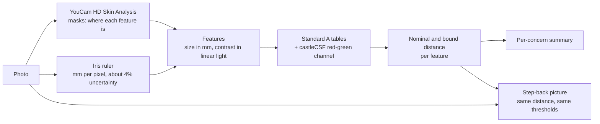

# Arm's Length: how the model works

This page follows one photo from pixels to a distance. Each section starts in plain words and then gives the
equations and numbers underneath. Every constant in the code appears in the [parameter table](#parameter-table) with its
source, and a test fails if the table and the code ever disagree. How well the model predicts real observers is in
[EVAL.md](EVAL.md); the YouCam side is in [YOUCAM.md](YOUCAM.md).

Contents: [In plain words](#in-plain-words) | [Pipeline](#the-pipeline-at-a-glance) |
[1. Masks to features](#1-from-youcam-masks-to-features) | [2. Iris ruler](#2-the-iris-ruler-and-its-uncertainty) |
[3. Contrast](#3-contrast-in-linear-light) | [4. Standard A](#4-the-standard-a-detector) |
[5. Colour](#5-colour-the-castlecsf-channel) | [6. The bound](#6-the-bound) |
[7. Summary](#7-from-features-to-a-summary) | [8. Step back](#8-the-step-back-picture) |
[9. Soft areas](#9-large-soft-areas) | [10. Worth it?](#10-worth-it-the-difference-an-improvement-would-make) |
[11. The lightest touch](#11-the-lightest-touch) | [12. Registration](#12-render-registration) |
[Parameters](#parameter-table) | [Limitations](#limitations) | [Sources](#sources)

## In plain words

You look at your skin from about 25 to 30 cm: a bathroom mirror, or a phone selfie (selfies are taken at about 30 cm,
Ward et al. 2018). The people you talk to are usually 1 m away or more. Eyes judge detail by angle, not by size, so as
you step back every mark on a face shrinks in the viewer's field of vision, and faint ones drop below what any eye can
detect. **The mirror is the wrong distance for asking what others can see.**

Arm's Length answers a narrower question that can be checked: *from how far could a person still detect each thing
YouCam found on your skin?*

- YouCam's skin analysis finds the features (spots, pores, lines, acne, dark circles, eye bags, redness).
- We measure each one: how wide it is in millimetres, using the iris as a ruler (an iris is 11.7 mm across on average),
  and how different it is from the skin around it, in linear light.
- A published model of human spatial vision, checked against data from 16 observers in 10 labs, turns size and contrast
  into the farthest distance at which an ideal observer could still detect the feature.

**What "visible from 2 m" means.** An observer with 20/20 vision, looking straight at that spot, knowing where it is,
in the stated lighting, could still detect it at 2 m. We make the observer sharper than the lab average on purpose:
a safety margin of 6 dB, which means the observer needs half the contrast the average person needs. Beyond 2 m, not even
that observer could see it, given the size and contrast we measured in your photo. So every distance is a ceiling ("at most"), never a forecast.

**What it does not mean.** It makes no claim about what anyone notices, cares about or thinks. Detecting is not noticing:
most people look at eyes and mouths, not at a pore. It says nothing about health or attractiveness, and it gives
distances, not grades. A mark that can be detected from 30 cm or from 3 m is simply a mark with a distance.

**Why one-sided.** Real viewers are less sensitive than our ideal one, they are rarely looking straight at the mark, and
skin texture around a mark hides it further. All of that only shortens the real distance. So the claim we can defend is
the upper limit.

**What the results look like.** A face has hundreds of pores and spots, so for those the answer is a proportion, not one
distance: "about a third of your dark spots can be seen across a table", said for a typical sharp-eyed person, with the
exact counts kept for a receipt (section 7). Large soft areas such as under-eye shadows get no distance at all, because
any ideal observer sees a large area at a few percent of contrast from far away, on every face, so we lead with that
fact (section 9). The same model also answers two practical follow-ups: *Worth it?* (if the picture looked like YouCam's
Skin Simulation at half strength, from how far could anyone tell the difference? section 10) and *The lightest touch*
(the lowest foundation coverage that gets most of the effect on a virtual try-on, section 11).

## The pipeline at a glance



| Step | In | Out | Code |
|---|---|---|---|
| 1. Masks to features | YouCam masks, photo | Place, size in pixels, contrast for each feature | `lib/skin` |
| 2. Iris ruler | Face landmarks | Millimetres per pixel, with an uncertainty | `lib/scale` |
| 3. Contrast | Photo in linear light | Weber and red-green contrast | `lib/skin` |
| 4-6. Visibility | Size in mm, contrast, lighting | Nominal and bound distance for each feature | `lib/vision` |
| 7. Summary | All the distances | A bound profile and a nominal profile (share of features detectable at fixed distances) for many-feature concerns, one distance for regions | `lib/vision/report.ts` |
| 8. Step back | Photo, scale, distance | The photo as an ideal observer sees it from there | `lib/vision/renderer.ts` |
| 9. Soft areas | Region measurements | The soft-area wording, with no distance, instead of a long distance | `lib/copy/describe.ts` |
| 10. Worth it? | Photo, half-strength Skin Simulation | Distance at which the change stays detectable | `lib/vision/worthIt.ts`, `lib/skin/counterfactual.ts` |
| 11. The lightest touch | Foundation renders at 50, 75, 100 | The lowest coverage that gets most of the effect | `lib/coverage/plan.ts` |
| 12. Registration | Photo, a render | The shift that aligns the render to the photo | `lib/coverage/register.ts` |

No language model is involved anywhere. The same photo and masks give the same numbers, and every sentence comes from
templates (`lib/copy`).

## 1. From YouCam masks to features

**In plain words.** YouCam draws a mask for each concern. A mask is a drawing of where something is, not a measurement
of it, so we read each kind of mask for what it really contains and measure the rest in the photo.

**The detail.** HD masks are images with an alpha channel. Most carry a dark layer at a fixed alpha over nearly the whole
frame, so the alpha value that occurs most often is the background, and a mark is any pixel whose alpha differs from it
by at least 8 (of 255). Masks are the same size as the photo and line up with it to within about 1 pixel
([YOUCAM.md](YOUCAM.md), section 3).

| Concern | What YouCam draws (HD) | How we read it | Size | Contrast | Shape the model sees |
|---|---|---|---|---|---|
| Age spots | Closed outline, transparent inside | Holes filled; 8-connected components of at least 6 px | Diameter of the equal-area circle, from the mask | Mean light inside against a ring of nearby skin | Uniform disk |
| Wrinkles | Thin lines, about 3 px wide | Skeleton of each stroke; short fragments dropped | Length: longest path along the skeleton. Width: measured across the line in the photo | Depth of the dip against its flanks | Line of that width and length |
| Pores | Dots of one fixed size (7 px): a location | Location only; touching dots split by area | Full width at half maximum of the photo's radial profile, else a prior of 0.3 mm | 3 x 3 pixel box at the location against a ring | Gaussian blob of that width |
| Acne | Rings of one fixed size (17 px): a location | Location only | As pores (luminance or red-green profile); prior: half the ring | Luminance and red-green | Uniform disk |
| Dark circles, eye bags | Soft, graded region | Extent where the mask exceeds 15% of its maximum | Equal-area diameter of the region | Alpha-weighted mean against a band of cheek just below | Soft-edged disk |
| Redness | Zones with graded cut-outs; empty when YouCam finds none | As regions | As regions | Red-green against skin outside all zones. Luminance is measured but not used (section 5) | Soft-edged disk, with colour |
| Texture | A sampling window | Used only as the skin area for reference colours | None | None | Not scored |

The regional masks YouCam also returns (forehead, nose, cheek for pores; forehead, crow's feet and so on for wrinkles)
are used only to label where on the face a feature sits.

**Wrinkle width and contrast come from the photo.** The mask stroke is a drawing about 3 px wide whatever the crease
looks like. We average the luminance across the line along its skeleton, search one lateral offset per wrinkle within
3 px (YouCam's line can sit a few pixels off the crease), and take the dip's depth against the flanks as the contrast and
its full width at half depth as the width. A dip shallower than 3% or less than three standard errors counts as no
dip, and the mask width is used instead, with the size source recorded as "mask".

**Pores and acne are point markers.** The mask says where, not how big: the same 7 px dot marks a 0.2 mm pore and a
0.5 mm one. We therefore measure each marker in the photo. Photo sizes are limited by blur (never under 2 px, 3 px for acne), so they are
upper bounds on the true size with the contrast diluted to match. When a marker stands less than two noise standard
errors above its surroundings we do not invent a measurement: the size becomes a stated prior (pore 0.3 mm, acne half the
ring) and `sizeSource` says `"prior"`. The size source caps the confidence shown for the concern (section 7).

**Regions.** Dark circles and eye bags are compared with the cheek band just below them (starting 12% of the region's
height under it, 40% tall; the whole face's skin is used if the band is too small). Redness is compared with the skin
outside all the redness zones. A mask with nothing in it is reported as "nothing found", not as a distance of zero.

## 2. The iris ruler and its uncertainty

**In plain words.** A photo does not know how big anything in it is. The one object of nearly known size on every face is
the iris. Its horizontal width is 11.71 mm on average, so counting its pixels gives millimetres per pixel. People differ
a little, so the answer comes with an honest error bar of about 4%, and every distance carries it.

**The detail.**

- **Measurement.** A face-landmark model locates four points on each iris. For each eye we take the more horizontal pair,
  average the two eyes, and set `mm per px = 11.71 / iris px`.
- **Population spread.** The iris (white-to-white corneal) diameter is 11.71 mm with a standard deviation of 0.42 mm
  (Rüfer, Schröder & Erb 2005). That is 3.6% before any measurement error.
- **Landmark error.** We assume each iris-edge point is off by 1 px (1 SD), averaged over the eyes found, and never less
  than half the left-right disagreement, which also absorbs head turn and blur. It adds in quadrature:
  `relSd = sqrt(0.0359^2 + landmark^2)`. For a 100 px iris that is 3.7%; smaller irises (a webcam) give more.
- **Distances scale linearly with size.** The model only sees size divided by distance, so a 4% error in size is a 4%
  error in distance. Each target's report carries `[bound x (1 - relSd), bound x (1 + relSd)]`.
- **Card option.** Holding an ID-1 bank card (85.60 x 53.98 mm, ISO/IEC 7810) flat against the forehead gives the scale
  from the card's edges. The relative uncertainty is about 1% or less for a flat card and grows with tilt; a shape whose aspect
  ratio is more than 15% off a card's is rejected.
- **No ruler.** Without an iris or a card the scale is marked "assumed" and every concern's confidence drops to low.

## 3. Contrast, in linear light

**In plain words.** Contrast is how much lighter, darker or redder a feature is than the skin around it. We work out
light the way the eye receives it, not the way JPEG stores it. Stored pixel values are bent by a curve (sRGB gamma), so
"10% darker" in stored values is a very different amount of light.

**The detail.**

1. Decode each pixel from sRGB to linear light (IEC 61966-2-1).
2. **Luminance** `Y = 0.2127 R + 0.7152 G + 0.0722 B` (Rec. 709 weights, the middle row of the linear-sRGB-to-XYZ matrix).
3. **Weber contrast** `C = (Y_feature - Y_surround) / Y_surround`. Negative means darker. Dark spots, pores and lines are
   negative. The model uses the size `|C|`, so a light mark of equal contrast is equally detectable.
4. **Surround.** A ring of nearby skin that excludes other features. Pixels more than 3 robust sigmas (1.4826 x MAD) from
   the ring's median are dropped (hair, glints, neighbouring marks). A ring that is too crowded is widened, and the
   face's skin is the last fallback.
5. **Red-green contrast.** Linear RGB goes to XYZ (D65) and then to cone signals L and M (Hunt-Pointer-Estevez matrix).
   The cone contrast on the L-M axis is `rg = dL/L - dM/M`, feature against surround; positive means redder. Neutral
   greys give 0. Because only ratios are used, each cone's overall gain cancels.

Red-green matters because a flush differs from skin in hue more than in brightness, and a luminance-only model would call
it invisible. Yellow-violet contrast is not measured (the channel is in the model and is passed 0); it is the least
sensitive channel for small features, roughly ten times below red-green for a 1 deg^2 target at 100 cd/m^2.

A measured luminance contrast is what the photo shows. If the phone or a filter has already smoothed the skin, the
contrast we see is lower than the contrast a person standing there would see (Limitations, item 1).

**Two contrast bases.** Every target carries a `contrastBasis`. The default is `"surround"`: the feature against the skin
around it, which is what another person sees. The second is `"counterfactual"`, used only by *Worth it?* (section 10): the
photo against a YouCam Skin Simulation of the same face with the concern improved, `(photo - simulation) / simulation` in
linear light. Sizes, ids and the detector are the same; only the reference changes. We first tried the counterfactual as
the default for dark circles, eye bags, lines and redness, and dropped it: at full strength it removes more than any
natural variation (section 10), and the simulation is a rendering by a model we cannot inspect, so it is the wrong
reference for "what do others see".

## 4. The Standard A detector

**In plain words.** Watson & Ahumada (2005) published an equation that predicts, for a pattern of a given size and
contrast, whether a person with good vision can just detect it. They set its few constants so that it matches how 16
observers in 10 laboratories actually performed on 43 test patterns (the ModelFest data), including the same shapes as
our features: soft blobs, a disk, a thin line, an edge. We use their published constants unchanged. It works in three
steps: the eye is most sensitive to medium-fine detail and much less to very fine or very broad detail; the person is
looking at the feature, so detail near the centre of gaze counts most; and the response is added up over the whole area,
which is why a 3 mm spot is easier to see than a 0.3 mm pore of the same contrast.

**The detail.** For a contrast image `c(x, y)` of the feature (background 0):

```text
filtered(x, y) = IFFT[ FFT(c) . S(f) . O(f, theta) ]                 CSF and oblique effect, in the Fourier domain
S(f)           = G . ( sech[(f / f0)^p] - a . sech[f / f1] )         f in cycles per degree
O(f, theta)    = 1 - (1 - exp(-(f - gamma) / lambda)) . sin^2(2 theta)   for f > gamma, else 1
A(r)           = exp(-r^2 / (2 sigma^2))                              Gaussian aperture, r in degrees from the feature
R              = [ sum px . py . | A(r) . filtered(x, y) |^beta ]^(1 / beta)     Minkowski pooling over the image
detected  iff  R >= 1
```

`G, f0, f1, a, p, beta, sigma` are Standard A's constants (Table 5 of the paper) and `gamma = 3.48`,
`lambda = 13.57` the paper's oblique-effect constants (Berkley et al. 1975); all are in the
[parameter table](#parameter-table). The convention is 120 pixels per degree and a 256 x 256 grid. Nothing is fitted
by us.

**Precomputed shape tables.** Every stage before the pooling is linear and the pooling scales exactly with contrast, so
the threshold contrast of a feature of unit contrast depends only on its shape and its angular size. We compute it once,
offline, from the closed-form Fourier transform of each shape (Gaussian, disk by a Bessel function, soft disk, rectangular
line), and the app only looks it up:

| Table | Indexed by | Grid |
|---|---|---|
| `gaussian` | sd of a 2-D Gaussian blob | 200 points, 0.01 to 300 arcmin |
| `disk` | equal-area diameter of a uniform disk | 200 points, 0.01 to 300 arcmin |
| `softDisk` | equal-area diameter of a Gaussian-edged disk | 200 points, 0.01 to 300 arcmin |
| `line` | width of an infinitely long line | 200 points, 0.01 to 300 arcmin |
| `lineLength` | width x length of a finite line | 40 x 46 points (0.02 to 120 and 0.02 to 360 arcmin) |
| `patch` | carrier of a one-octave Gabor patch (for the Step-back picture) | 16 points, 0.25 to 45 cycles/deg |

All are for Standard A at ModelFest's 30 cd/m^2. Lookups interpolate linearly in log size and log threshold. Below the
smallest size the exact small-feature rule applies (threshold proportional to 1/area for blobs, 1/width for lines); above
the largest, the table's last value (the response saturates once the feature fills the aperture). Lines use no oblique
penalty, which is their most visible orientation, the safe choice for a bound. `scripts/vision/build-tables.ts --check`
rebuilds the tables and reports the difference; tests compare lookups with direct computation (within 0.05 dB for blobs
and 0.1 dB for lines).

**At a distance `d`.** A feature of physical size `s` subtends `theta = 2 atan(s / 2d) / acuityScale` (`acuityScale` 1
is 20/20; 2 is 20/40). Then:

```text
R_lum = |C| . g / T_shape(theta)          T_shape: unit-contrast threshold from the table for this feature's shape
```

**Luminance factor `g`.** The tables are for 30 cd/m^2; faces are seen at other brightness. `g` is castleCSF's
achromatic sensitivity at the viewing luminance divided by its value at 30 cd/m^2, evaluated at `f* = 1/(4 s)` cycles per
degree for a blob of angular sd `s` (clipped to 1-16). At 4 cycles/deg it is 0.45, 0.73, 1.00, 1.22, 1.33, 1.38 at
3, 10, 30, 100, 300, 1000 cd/m^2. This is our heuristic, not a published result (Limitations, item 6). The nominal
distance uses `g`; the bound uses `max(1, g)`, so a dim room can never make the bound shorter.

**Fixation.** The aperture is centred on the feature: the ideal observer looks exactly at it, the most favourable case.

**Why not something simpler.** A single contrast threshold per spatial frequency ignores spatial summation, which is
what separates a 3 mm spot from a pore. Barten's full model is built for large gratings and is about 2.6 times too
sensitive for ModelFest's Gaussian-windowed patterns, so we use it only as a sanity check on the luminance trend. A peak
(max-over-bands) detector, which is what Peli's rule amounts to, has 4.5 dB RMS error on ModelFest against about 1 dB for
the pooled model (Watson & Ahumada 2005); we use Peli's rule only for the picture (section 8).

## 5. Colour: the castleCSF channel

**In plain words.** Standard A was measured with black-and-white patterns. The eye handles colour differences with
separate machinery: poor for tiny details, surprisingly good for larger patches. For concerns where colour carries the
signal (acne and redness) we add a red-green term from castleCSF (Ashraf, Mantiuk, Chapiro & Wuerger 2024), a recent
sensitivity model for colour, size and brightness.

**The detail.**

- **Port.** The static, foveal part of castleCSF (MIT licence, copyright notice kept in `lib/vision/castle.ts`) is ported:
  three channels (achromatic, red-green, yellow-violet), each `S = S_peak(rho, L) . sqrt(A_c / (1 + A_c / A)) . rho`
  with the critical area `A_c = A0 / (1 + (rho / f0)^2)` (the Rovamo et al. 1993 area model). Time and eccentricity terms
  equal 1 for a static, centrally viewed target. The port reproduces rows of castleCSF's own data files to 1e-4 in log10
  against a reference port, and sits within 4 dB of the data (Gabors) and 3.5 dB (discs). The paper reports 3.59 dB over
  18 datasets. Bit-exactness against the authors' reference implementation is not tested.
- **Discs.** Small isolated features use the paper's disc extension, `S_disc(r, L) = k_r . r^(1/beta) . max over rho of
  S(rho, A = 2.42437 deg^2, L)` with `beta = 3.01142` and `k_r = 2 pi` (the paper's form; the authors' code uses 1, and
  the paper's form fits their own disc data at 3.17 dB RMS against 5.54 dB).
- **Small radii.** Their disc data stop at a radius of 0.083 deg (5 arcmin), and extrapolating the formula to pore size
  would make a 3 mm spot of 12% contrast "visible" beyond 100 m. Below 0.083 deg we use `S` proportional to `r^2`
  (Ricco's law), anchored at 0.083 deg. This is our heuristic.
- **Channel contrast.** Our measured `(lum, rg)` becomes castleCSF's `C_RG = |dL - 2.3112 dM| / (L0 + M0)` by
  `C_RG = |a . lum + b . rg|`, with `a` and `b` from the table below, for a typical skin colour. It reproduces castleCSF's
  own value to 3% on four skin-against-redder-patch pairs.
- **Combining.** Channels add as energy, castleCSF's own rule:

```text
R_RG    = C_RG . S_RG,disc(r, L)          R_YV = 0 (not measured)
R_total = sqrt(R_lum^2 + R_RG^2 + R_YV^2)
```

- **When it applies.** Only to concerns marked chromatic: **acne and redness**. For the others the term is 0. For acne,
  colour adds to the luminance term and can only add visibility, never remove it.
- **Redness is judged on colour alone.** Its luminance contrast is set to 0 before the detector, on either contrast basis
  (`specFromTarget` in `lib/vision/visibility.ts`). Why: a redness zone sits on a cheek, and the cheek's brightness is
  mostly the lighting. On the recorded faces the luminance of redness zones differs from the skin outside them by up to
  31% either way (+31% on p1a, -31% on p3a), while the red-green contrast is only 0.002 to 0.037 in size. Letting the
  brightness decide would measure the lamp, not the redness. The cost: a zone that is also truly darker is judged on its
  colour only (Limitations, item 8).

## 6. The bound

**In plain words.** Each feature gets two distances. The **nominal** distance is where an average observer in a lab
would just fail to see it. The **bound** assumes an observer who needs half the contrast, 6 dB sharper than average, and
that is the number we show: beyond it, the feature is invisible even to very good eyes looking for it.

**The detail.**

```text
detected  iff  10^(margin / 20) . R_total >= 1
nominal:  margin = 0,   g as computed
bound:    margin = 6 dB,  g = max(1, g)
```

**Why 6 dB.** ModelFest tells us how far people differ from the model:

| Evidence | Size |
|---|---|
| Most sensitive of the 16 ModelFest observers, against the mean | 4.2 dB (the second most sensitive: 3.95 dB) |
| Largest under-prediction of visibility on skin-like shapes (the thin line, #31) | 1.95 dB |
| castleCSF disc thresholds against Standard A at 20-200 cd/m^2 | 2.9 to 8.1 dB (overlaps the rows above) |
| Criterion (84% correct) and viewing time (0.31 s effective in the lab) | roughly 1 to 3 dB (unverified) |

Adding everything (11 to 15 dB) would multiply distances by 3 to 5 and say little, and the sources overlap. We take
the best observer plus the model's residual on skin-like shapes: **6 dB, with a range of 0 to 9 dB**. For a 3 mm disk of
12% contrast, the distance is 3.2 m at 0 dB, 4.8 m at 6 dB and about 5.9 m at 9 dB. For scale, individual observers
differ from the across-observer mean by 3.46 dB RMS, so 6 dB covers the sharpest observers of the 16.

**The scan.** For each feature we want the largest `d` at which the test passes. We evaluate about 150 distances on a log
grid from 1 cm to 50 m, scanning from far to near, and refine the last crossing by bisection (30 halvings). A scan rather
than bisection alone guards against curves that are not monotone (short lines, mixed shapes). The report says 0 when the
feature is already gone at 10 cm, and caps at 10 m. The interval comes from the scale's uncertainty (section 2).

**What the claim assumes.** The bound holds if the photo's contrast is at least the real contrast (no beauty filter, no heavy
smoothing) and the pixel scale is right. It does not rely on masking by skin texture, which only helps it.

## 7. From features to a summary

**In plain words.** A face has hundreds of pores and spots, and "how far can the most visible one be seen?" is the wrong
question to ask of them. So for concerns with many features (pores, dark spots, lines, breakouts) we count how many
features an ideal observer could still see at each of several distances, and say it in proportions, such as "most" or
"about a third", with the exact counts kept for the receipt.

**Why the maximum is fragile.** The farthest single feature is decided by one outlier. On the first real run on p2b, the
top "pores" were 1.4 to 1.8 mm marks that YouCam had also tagged as something else, and the headline distance came from
them while the typical pore sat far closer. Today (after the fixes below) p2b's pores have a farthest bound of 4.2 m, a median of
1.55 m, and 5 of 649 reach 4 m. Quoting 4.2 m would say nothing about the other 644. The maximum is still reported
(`maxDistanceM`), but it is not the headline.

**The detectability profile.** At each of the fixed distances **0.25, 0.3, 0.6, 1, 1.5, 2.5, 4 and 6 m**
(`PROFILE_DISTANCES_M`, from mirror distance to well across a room), we count the concern's features whose bound
distance is at least that far, and give the share of all of them (`ConcernVisibility.profile`). Between the fixed
distances the app interpolates on a log axis. Because the bound distance is a ceiling (section 6), each count is a
ceiling too: the real number a person could see is lower. So the report carries a second profile, the **nominal
profile** (`nominalProfile`), counted the same way from each feature's nominal distance (average observer, margin 0). The
copy keeps the two apart. Visible-side sentences ("a typical sharp-eyed person looking right at them could pick out about
a third of your dark spots from across a table") read the nominal profile. Relief sentences ("even perfect eyes couldn't
pick out your pores past 40 cm") read the bound, with the viewing assumptions in the same sentence. A headline gives a proportion
in words ("most", "about a third", "a few") and never a count; the exact counts appear only in a receipt, with both
observers side by side. A concern counts as a relief when at most 10% of it is detectable across a table (1.5 m) by the
bound, and a profile is used when a concern has at least 5 features and is not an area region.

**Rules applied before counting.**

- **No double counting (marker dedupe).** A pore or acne marker that sits inside a measured age spot is that spot, not a
  second feature, and is dropped. On the recorded faces this removes 22 pores and 17 breakout markers on p1a, 7 and 1 on
  p2b, 19 and 2 on p3a, and 5 pores on p5a.
- **Implausible pore sizes (the pore size prior).** A pore whose measured width is above 1.2 mm is not a pore opening but
  another mark at a pore location, so its size falls back to a 0.5 mm prior and is flagged `sizeSource: "prior"`. The
  numbers are assumptions: Flament et al. (2015) count facial pores from 0.25 mm upward, and we take about 0.5 mm as the
  upper end of an enlarged pore (our order-of-magnitude reading, not a figure from that paper). Unflagged, these marks
  would be the longest-carrying "pores". The synthetic demo faces were prompted to have visible pores, and their pores
  measure about 0.5 mm wide, twice that cutoff, so their pore counts are probably high compared with real skin.
- **Regions** (dark circles, eye bags, redness) are single large shapes and keep a single distance each. For dark circles
  and eye bags that distance is not a useful measure (section 9).

**Still reported:** the farthest feature, the median over the concern, the scale-uncertainty interval of the farthest,
and the five most visible features' ids.

**Confidence.** A base level by concern: high for age spots, wrinkles and dark circles (sharp outlines, lines and
regions); medium for pores, eye bags and redness (location-only markers or soft edges); low for acne and texture. It is
capped by where the headline feature's size came from: from the mask keeps the base, from the photo caps at medium, a
prior makes it low. An "assumed" scale makes every concern low.

## 8. The Step-back picture

**In plain words.** The slider shows your own photo as an ideal observer would see it from a chosen distance. Detail that
is below what the eye can detect at that distance fades out; detail above it keeps its full strength. Nothing is redrawn,
sharpened or invented; the picture is your photo with the parts nobody could see switched off. It uses the same distance,
the same lighting and the same 6 dB margin as the numbers.

**The detail.** After Peli (1990, 1996):

1. Take the photo's linear luminance and split it into one-octave bands in the Fourier domain with cosine-log filters.
   The bands plus a low-pass residual add up to the original exactly.
2. For each band, local contrast is `c_j = a_j / l_j`, the band's amplitude over the local mean brightness of everything
   below it (Peli's low-pass image `l_j`, floored at 0.02 of white).
3. The band's frequency in cycles per degree comes from the iris-based scale and the distance. Its threshold is the
   Standard A **patch** threshold (a one-octave Gabor patch; ModelFest stimuli #11-14 are this family) divided by the
   luminance factor `g` (or `max(1, g)`) and by `10^(margin / 20)`. That is the same rule as the numbers.
4. Where `|c_j|` is above the threshold, the band is kept. Below it, it fades. The change is smooth between 0.7 and 1.3
   times the threshold (ours; Peli used a hard step), so the slider shows no banding.
5. Add the bands back, and scale each pixel's linear RGB by the new luminance over the old one. Colour is carried along;
   alpha is copied.

Photos over 512 px on the long side are processed at 512 px, with the finer detail added back as one extra gated band.
The pyramid is built once per photo and cached, so moving the slider only re-thresholds: about 150 ms the first time for
a 512 x 512 photo and about 25 ms per move after that.

**Why believe it.** Peli (1996) tested this kind of simulation on four observers. They could still tell a simulation
from the original 16% and 39% farther away than predicted for the 1 and 2 degree faces (9% farther and 12% nearer once the
original's finest detail was removed), and equality was not rejected. So the method is about right and, if anything,
slightly generous: a real viewer can see a little more than the simulation kept, which is the direction our margin is
meant to cover. The picture uses Peli's validated rule, the numbers use the pooled model; both are calibrated from the same
Standard A thresholds but they are different detectors, so they agree closely but not pixel for pixel.

## 9. Large soft areas

**In plain words.** For under-eye shadows and puffiness a distance is not a meaningful number. These are areas 3 to 4 cm
wide, and a large area is easy to see: even a few percent of contrast over that size is detectable from far away by an
ideal observer, on anyone's face. A long distance would say the area is large, not that the shading is strong, and it
would ask the person to read it as a grade. So for these two concerns, and for a broad flush of redness, the copy states
no distance at all, in the headline or the detail.

**The detail.**

- **The physics.** The detector sums over area (section 4), so threshold contrast falls as a feature grows. A 35 mm
  soft-edged disk at only 3% contrast has a bound of 22.9 m (11.5 m for the average observer) at ModelFest's 30 cd/m^2;
  the app caps reports at 10 m. The last row of the table in [EVAL.md](EVAL.md#4-illustrative-distances) is generated
  from the code.
- **What the recorded faces measure.** Against the cheek band below them, dark circles come out at -0.26 to -0.55
  Weber contrast and eye bags at -0.14 to -0.51, over regions 31 to 46 mm wide, on all four recorded faces, including
  the fine-skinned p5a. That is ordinary eye-socket shading and not a sign of anything on the skin, and every one of
  them lands at the 10 m cap. A distance that every face shares does not discriminate between faces.
- **What we report instead.** The copy leads with the universal fact ("Under-eye shadows are a large, soft area; on
  everyone, they're among the last things to fade with distance", `lib/copy/describe.ts`) and gives no distance and no
  grade. YouCam's own 0 to 100 score is not shown on the cards: it is a grade, it does not measure visibility, and the
  distances are not built on it. The contrast basis is still the surround (section 3), and the measurement is still in
  the report.
- **Where the change matters.** The question that does tell soft areas apart is "how much would an improvement change?",
  which is *Worth it?* (next section).

## 10. "Worth it?": the difference an improvement would make

**In plain words.** The usual number says what others can see of a concern as it is. *Worth it?* asks whether a change
would show: if the picture looked like YouCam's Skin Simulation at half strength, from how far could anyone tell the photo
from the simulated version? Small features give a short distance (a typical person would not see the change); a large
soft area gives a long one. It is a simulation of a possible change in the picture, not a result for any product or
routine, and the same kind of claim as everything else here: a ceiling for an ideal observer looking straight at it,
never a forecast of what anyone notices.

**The contrast.** Each target keeps its size and id; only its contrast changes, to the difference between the photo and the
simulation, in linear light:

```text
C = (Y_photo - Y_sim) / Y_sim          red-green: dL/L - dM/M, photo against simulation, as in section 3
```

How `Y_photo` and `Y_sim` are taken depends on the target, always at the same place in both images
(`lib/skin/measure.ts`, `lib/skin/features.ts`):

| Target | Where the two images are compared |
|---|---|
| Age spots | Mean over the spot's filled outline |
| Pores, acne | A 3 x 3 pixel box at the marker |
| Wrinkles | Along the line's cross-sections, with the same one-offset search within 3 px as in section 1; the offset where the difference is most negative; at least 4 cross-sections |
| Regions (dark circles, eye bags, redness) | Alpha-weighted mean over the region |

Then the usual chain runs unchanged: shape, angular size, the detector, the same viewing light and the same 6 dB margin,
and the same summary (maximum, median, profile). Redness stays chromatic-only. A concern the simulation did not change
comes out near 0 contrast and near 0 m, so the render has to be one that changed the concern asked about
(`lib/vision/worthIt.ts`). The simulation is brought into the photo's frame first, by registration (section 12).

**Why half strength, not full.** Skin Simulation takes a strength from 0 to 1 per concern. We first tried 1.0 and found
that it beautifies beyond natural. At strength 1.0 the under-eye regions of the two faces YouCam scores 90 and 92 on dark
circles (raw score, p3a and p5a) still come out 14% to 25% lighter, region by region (18% to 24% in our first
measurement), so even a face with little to improve loses roughly a fifth of its under-eye darkness. That is not a "realistic
improvement". We use **0.5** instead. It is a choice, not a calibration: the same regions come out 8% to 16% lighter at
0.5, which is 55% to 64% of the full change, so 0.5 is not exactly half, and nothing ties the strength scale to a physical
quantity. We record two simulations per face, 4 units each: group A (dark circles, eye bags, wrinkles and redness at 0.5)
and group B (spots, pores and acne at 0.5).

**What it shows.** The table in [EVAL.md](EVAL.md#7-what-would-an-improvement-change-worth-it) is generated by running
`worthIt` on the recorded simulations. In short: a half-strength change to pores shows on at most 4% to 14% of a face's
pores across a table and on none at 4 m; a change to under-eye shadows and puffiness is detectable at the 10 m cap on every
recorded face. Pores: a typical person would not see the change. Under-eye: a large soft area, so even a small change
reaches the 10 m cap on any face.

**Limits.** The simulation is YouCam's rendering and we cannot inspect it. We have one render per group per face, and have not
tested whether the same request gives the same render twice. The result covers only what the simulation changed, and a
bigger change always reaches farther.

## 11. The lightest touch

**In plain words.** To find the least foundation that hides a concern, we render the face at a few coverage levels, measure
each render exactly as we measured the photo, and pick the lowest level that gets most of the effect. The renders come from
YouCam's Makeup Virtual Try-On; the measurement and the choice are ours.

**The detail** (`lib/coverage/plan.ts`).

- **The lever.** Foundation `coverageIntensity`, always with a `skin_smooth` effect at 0 first. With smoothing left at its
  default the service blurs and brightens everything (about +23% in linear luminance, background included); with it at 0 a
  render without makeup is bit-identical to the input, so the "no makeup" baseline costs nothing, and every makeup effect is
  local ([YOUCAM.md](YOUCAM.md#4-integration-notes-we-learned-the-hard-way), notes 4 and 5).
- **The metric.** The share of the concern's targets whose bound distance reaches **1.5 m** (across a table), the same
  profile measure as section 7. The maximum is no use: the strongest single mark (a dark mole sat at the 10 m cap on every
  recorded face) stays visible at any coverage, so a rule "the maximum falls below d" is never met.
- **The search.** The grid is 25, 50, 75, 100, with at most 4 renders. The response is monotone in the recorded data, so we
  render 50 first. If 50 already leaves at most 10% of the targets detectable (`MET_FRACTION`), we try 25, and the answer is the
  lowest level that meets it. Otherwise we try 75, then 100, and take the first that meets it.
- **The knee.** When nothing reaches 10%, the answer is the lowest coverage that achieves at least **80%** of the reduction
  that 100% coverage achieves (`KNEE_SHARE`), i.e. where most of the effect is. If 100% reduces nothing, there is no answer
  and the status is `no_effect`. The 25 render is made only when 50 already reaches the knee.
- **What has no lever.** Concealer did not respond in our tests (its `coverageLevel` 20, 50 and 90 renders differ by 0.03 of
  255 on average, and `colorUnderEyeIntensity` moved dark-circle contrast by 0.4% in total). **Dark circles and eye bags have
  no makeup lever** in what we tried (the best case was a 6% drop with foundation that did not grow with coverage); their
  what-if goes through Skin Simulation. Wrinkles and redness were not tested, so they are reported as having no verified
  lever, not searched. Texture is not a visible mark.
- **Every number is checked on the render.** Each step is a recorded or live render, registered to the photo (section 12)
  and measured again on the same masks, so a plan is never a prediction from a formula.

The per-face results from the recorded foundation grid are in [EVAL.md](EVAL.md#8-the-lightest-touch-on-the-recorded-renders). On
the three recorded faces full coverage does not take spots, pores or breakouts to 10% across a table, so the answer is the
knee; it takes the share of detectable pores from 53% to 22% on p2b.

## 12. Render registration

**In plain words.** A render from YouCam is not always the same size or position as the photo we sent. To compare the two at
the same pixels, we measure how far each render is shifted and undo it.

**The detail** (`lib/coverage/register.ts`). The shift is **per render, measured**, not a constant:

| Face | Render size for the input | Shift | Padding |
|---|---|---|---|
| p2b | 1080 x 1340 for 1080 x 1341 | +1 row (`dy` 1) | Black first row |
| p3a | 1078 x 1576 for 1080 x 1575 | `dx` -3 | Black last row and column |
| p1a | 1080 x 1610 for 1080 x 1610 | None | None |

Convention: `render(x + dx, y + dy) = input(x, y)`. A rule based on the output size would have been right for p2b and wrong for the
other two, which is why we measure.

- **Method.** Normalised cross-correlation of blurred luminance (box blur, radius 2), over the most textured 64 px blocks
  of the input (4 to 40 of them, those with a luminance sd of at least 6), for every whole-pixel shift within +-6 px. NCC
  ignores the gain and offset that smoothing or tone changes add, and a pure translation is all the service applies.
- **Padding.** Up to 4 px of black border at the render's edge counts as padding and is left out of the valid region, so
  it is never sampled.
- **Trust.** A registration whose mean NCC is below 0.6 is not trusted (the recorded renders score 0.87 to 0.99), and the
  offset the service client reported is used instead. Simulations are pixel-aligned (within 0.06 px on three faces, 0.15 px
  on p3a) but go through the same registration, so a shift would be caught.
- **Precision.** Whole pixels only; the patch-wise measurements on the recorded renders have a spread of 0.03 to 0.15 px, so
  the integer is right to well under a pixel. At 0.17 mm per pixel that is 0.03 mm, which matters for 1 to 3 px features
  such as pores and lines, and not for regions.

## Parameter table

Every constant of the model, with its source. These tables are generated from the code by
`npx tsx scripts/docs/params-table.ts --write`, and `lib/vision/params.doc.test.ts` fails if they drift. "Ours" marks the
few choices we made ourselves; "Heuristic" marks values chosen from recorded masks and photos; everything else comes from
the cited source and is not fitted by us.

<!-- generated:params-model:start -->

### Detector: Watson & Ahumada Standard A

Taken from the paper as published. Nothing here is fitted by us.

| Parameter | Value | Unit | Source |
| --- | --- | --- | --- |
| `STANDARD_A.gain` | 373.08 | - | Watson & Ahumada 2005, Table 5 (Standard A). CSF gain G; the DC gain is G(1 - a) = 56.22 |
| `STANDARD_A.f0` | 4.1726 | cycles/deg | Watson & Ahumada 2005, Table 5 (Standard A) |
| `STANDARD_A.f1` | 1.3625 | cycles/deg | Watson & Ahumada 2005, Table 5 (Standard A) |
| `STANDARD_A.a` | 0.8493 | - | Watson & Ahumada 2005, Table 5 (Standard A) |
| `STANDARD_A.p` | 0.7786 | - | Watson & Ahumada 2005, Table 5 (Standard A). CSF peaks at 217.3, at 3.45 cycles/deg |
| `STANDARD_A.beta` | 2.4081 | - | Watson & Ahumada 2005, Table 5 (Standard A). Minkowski pooling exponent (2 would be energy summation) |
| `STANDARD_A.sigma` | 0.6273 | deg | Watson & Ahumada 2005, Table 5 (Standard A). Sd of the Gaussian aperture centred on the fixated feature |
| `OBLIQUE.gamma` | 3.48 | cycles/deg | Watson & Ahumada 2005, Eq. 5; fixed from Berkley et al. 1975, not fitted |
| `OBLIQUE.lambda` | 13.57 | cycles/deg | As above |
| `MODEL_GRID.ppd` | 120 | pixels/deg | ModelFest and Watson & Ahumada convention: 1 pixel = 0.5 arcmin |
| `MODEL_GRID.n` | 256 | pixels | ModelFest convention: 256 x 256 images |
| `STANDARD_FIELD_DEG` | 2.1333 | deg | Derived: n / ppd |
| `MODELFEST_LUMINANCE` | 30 | cd/m^2 | ModelFest mean luminance, 30 +/- 5; the tables are for this luminance |
| `STANDARD_B (gain, f0, f1, a, p, beta, sigma)` | 501.2, 4.3469, 1.4476, 0.8514, 0.7929, 2, 0.3652 | - | Watson & Ahumada 2005, Table 5 (Standard B, beta fixed at 2). Fallback only; the distances use Standard A |

### The bound, the distance scan and the report

| Parameter | Value | Unit | Source |
| --- | --- | --- | --- |
| `DEFAULT_MARGIN_DB` | 6 | dB | Ours, from ModelFest: best of 16 observers 4.2 dB below the mean, plus up to 1.9 dB model residual on skin-like shapes. Range 0 to 9 |
| `SCAN.minM` | 0.01 | m | Ours (numerical): nearest distance scanned |
| `SCAN.maxM` | 50 | m | Ours (numerical): farthest distance scanned |
| `SCAN.pointsPerDecade` | 40 | - | Ours (numerical): log grid, then bisection on the last crossing |
| `MIN_DISTANCE_M` | 0.1 | m | Contract (lib/contracts/vision.ts): below this the report says 0 |
| `MAX_DISTANCE_M` | 10 | m | Contract: the report caps distances here |
| `PROFILE_DISTANCES_M` | 0.25, 0.3, 0.6, 1, 1.5, 2.5, 4, 6 | m | Contract: fixed distances of the detectability profile (mirror, selfie, arm's length, conversation, table, room, far) |
| `DEFAULT_VIEWING` | 45 cd/m^2, acuityScale 1, margin 6 dB | - | Contract: indoor light, 20/20 observer, default margin |

### Viewing luminance and the luminance factor

| Parameter | Value | Unit | Source |
| --- | --- | --- | --- |
| `LUMINANCE_PRESETS.home` | 12 | cd/m^2 | Lambertian skin, L = rho E / pi with rho = 0.35 (the light-skin patch of a standard colour chart, Y = 35.8%); 50-150 lx (home, evening) |
| `LUMINANCE_PRESETS.indoor` | 45 | cd/m^2 | As above; about 400 lx (office, EN 12464-1 range 300-500) |
| `LUMINANCE_PRESETS.overcast` | 300 | cd/m^2 | As above; 1,000-5,000 lx (overcast, window light) |
| `LUMINANCE_PRESETS.daylight` | 1000 | cd/m^2 | As above; 10,000-25,000 lx (daylight, not direct sun) |
| `LUMINANCE_PRESETS.videoCall` | 80 | cd/m^2 | Adapted to a 200-300 cd/m^2 screen; face at about 0.35 of white |
| `LUMINANCE_FACTOR_FREQ_RANGE` | 1, 16 | cycles/deg | Ours (heuristic): the luminance factor g(L, f*) uses f* = 1/(4 s), clipped to this range; the bound uses max(1, g) |

### Feature shapes

| Parameter | Value | Unit | Source |
| --- | --- | --- | --- |
| `FWHM_PER_SD` | 2.3548 | - | 2 sqrt(2 ln 2). A pore's measured diameter is read as the full width at half maximum of a Gaussian blob |
| `SOFT_DISK_EDGE_SD_FRACTION` | 0.1 | of diameter | Ours: regions are equal-area disks blurred by a Gaussian of this sd (a 10-90% edge width of 26% of the diameter) |
| `PATCH_GABOR_SD_CYCLES` | 0.5621 | cycles | Peli 1996 patch CSF: a Gabor with sd = this / f0 degrees has a 1-octave bandwidth (ModelFest #11-14) |

### Chromatic channel: castleCSF, static and foveal

Used only for concerns where red-green contrast matters (acne, redness).

| Parameter | Value | Unit | Source |
| --- | --- | --- | --- |
| `CASTLE_ACH.sMax` | 56.4947, 7.54726, 0.144532, 5.58341e-7, 9.66862e9 | - | castleCSF default parameters (MIT licence), Ashraf et al. 2024. Achromatic S_max(L) = p1 (1 + p2/L)^-p3 (1 - (1 + p4/L)^-p5). Used by the luminance factor only |
| `CASTLE_ACH.fMax` | 1.78119, 91.5718, 0.256682 | - | castleCSF default parameters (MIT licence), Ashraf et al. 2024. f_max(L) = p1 (1 + p2/L)^-p3 |
| `CASTLE_ACH.bw, a` | 2.13047e-4, 0.100207 | - | castleCSF default parameters (MIT licence), Ashraf et al. 2024 |
| `CASTLE_ACH.area0, f0` | 157.103, 0.702338 | deg^2, cycles/deg | castleCSF default parameters (MIT licence), Ashraf et al. 2024. Critical area A0 and frequency f0 of the Rovamo et al. (1993) area model |
| `CASTLE_RG.sMax` | 681.434, 38.0038, 0.480386 | - | castleCSF default parameters (MIT licence), Ashraf et al. 2024. Red-green S_max(L) = p1 (1 + p2/L)^-p3 |
| `CASTLE_RG.fMax` | 0.0178364 | cycles/deg | castleCSF default parameters (MIT licence), Ashraf et al. 2024. Constant |
| `CASTLE_RG.bw` | 2.42104 | - | castleCSF default parameters (MIT licence), Ashraf et al. 2024 |
| `CASTLE_RG.area0, f0` | 2816.44, 0.0711058 | deg^2, cycles/deg | castleCSF default parameters (MIT licence), Ashraf et al. 2024 |
| `CASTLE_YV (sMax; fMax; bw; area0; f0)` | 166.683, 62.8974, 0.41193; 0.00425753; 2.68197; 2.82789e7; 6.35093e-4 | - | castleCSF default parameters (MIT licence), Ashraf et al. 2024. Yellow-violet channel; the code path exists but no yellow-violet contrast is measured, so it adds nothing |
| `CASTLE_DISC.beta` | 3.01142 | - | castleCSF paper Eq. 31, `sensitivity_edge`: S_disc = k_r r^(1/beta) max over rho of S(rho, A) |
| `CASTLE_DISC.area` | 2.42437 | deg^2 | As above: the fixed area at which the Gabor sensitivity is maximised |
| `CASTLE_DISC.kr` | 6.283185307 | - | 2 pi, the paper's circumference form. The repository code uses 1; the paper's form fits castleCSF's own disc data (RMS 3.17 dB against 5.54 dB) |
| `CASTLE_DISC.rhoMin, rhoMax` | 0.125, 16 | cycles/deg | castleCSF `sensitivity_edge`: the frequency range searched |
| `CASTLE_DISC.rhoSteps` | 64 | - | Ours (numerical): log-spaced samples over that range |
| `CASTLE_DISC.validRadiusDeg` | 0.083 | deg | Smallest disc radius in castleCSF's disc data; below it sensitivity falls as r^2 (Ricco's law, ours, unverified) |
| `CASTLE_COLMAT.rg` | 2.3112 | - | castleCSF `colmat` (Wuerger et al. 2020): red-green channel is L - this x M |
| `CASTLE_COLMAT.yv` | 50.9875 | - | castleCSF `colmat`: yellow-violet channel is this x S - L - M |
| `SRGB_TO_CASTLE_LMS` | 0.201315, 0.48242, 0.051011, 0.031887, 0.246411, 0.037985, 3.61e-4, 0.002012, 0.018447 | - | castleCSF `xyz2lms2006` (CIE 2006 2-degree cone fundamentals, Stockman & Sharpe) times the sRGB-to-XYZ matrix; row-major, L + M = Y |
| `RG_CONTRAST_MAP (lum, rg)` | 0.101, 0.6549 | - | Ours: C_RG = abs(lum x first + rg x second), for a skin colour with L/(L+M) = 0.7285. Reproduces castleCSF's C_RG to 3% on four skin pairs |

### Step-back renderer

| Parameter | Value | Unit | Source |
| --- | --- | --- | --- |
| `RENDERER.maxWorkSide` | 512 | pixels | Ours (speed): larger photos are processed at this size and the finer detail is added back as one extra gated band |
| `RENDERER.bandsPerOctave` | 1 | - | Peli 1990: one-octave cosine-log bands |
| `RENDERER.kneeLo` | 0.7 | x threshold | Ours: detail fades in smoothly between kneeLo and kneeHi (Peli used a hard step), so the slider shows no banding |
| `RENDERER.kneeHi` | 1.3 | x threshold | Ours, as above |
| `RENDERER.localMeanFloor` | 0.02 | of white | Ours: floor on the local mean luminance in the band-contrast denominator |

<!-- generated:params-model:end -->

<!-- generated:params-scale:start -->

### Scale: the iris ruler and the card

| Parameter | Value | Unit | Source |
| --- | --- | --- | --- |
| `IRIS_DIAMETER_MM` | 11.71 | mm | Rüfer, Schröder & Erb 2005: white-to-white corneal diameter, population mean |
| `IRIS_DIAMETER_SD_MM` | 0.42 | mm | Rüfer et al. 2005: population standard deviation |
| `IRIS_POPULATION_REL_SD` | 0.03587 | - | Derived: 0.42 / 11.71. The floor on the scale uncertainty |
| `IRIS_EDGE_SD_PX` | 1 | pixels | Assumption: sd of each iris-edge landmark. Two edges per eye, averaged over the eyes found |
| `CARD_LONG_MM` | 85.6 | mm | ISO/IEC 7810 ID-1 bank card, long side |
| `CARD_SHORT_MM` | 53.98 | mm | ISO/IEC 7810 ID-1, short side |
| `CARD_CORNER_SD_PX` | 1.5 | pixels | Assumption: sd of one corner position |
| `CARD_ASPECT_TOLERANCE` | 0.15 | relative | Ours: a quad whose aspect ratio is further than this from a card's is rejected (wrong object or too tilted) |

### Colour maths

| Parameter | Value | Unit | Source |
| --- | --- | --- | --- |
| `LINEAR_SRGB_TO_XYZ` | 0.4124564, 0.3575761, 0.1804375, 0.2126729, 0.7151522, 0.072175, 0.0193339, 0.119192, 0.9503041 | - | IEC 61966-2-1 (sRGB, D65) as tabulated by B. Lindbloom; row-major. The middle row is the luminance weights |
| `XYZ_TO_LMS_HPE_D65` | 0.4002, 0.7076, -0.0808, -0.2263, 1.1653, 0.0457, 0, 0, 0.9182 | - | Hunt-Pointer-Estevez matrix normalised to D65 (Hunt, The Reproduction of Colour; Fairchild, Color Appearance Models); row-major. Only ratios (dL/L, dM/M) are used, so each cone's gain cancels |

<!-- generated:params-scale:end -->

<!-- generated:params-measurement:start -->

### Measurement stage: reading masks and photos

These are heuristics chosen from the recorded masks and photos (docs/YOUCAM.md, section 3), not published model parameters. None of them feeds the vision model's constants.

| Parameter | Value | Unit | Source |
| --- | --- | --- | --- |
| `DEFAULT_MIN_DIFF` | 8 | alpha steps | A pixel is foreground when its alpha differs from the mask's modal alpha by at least this much. Sits above the HD pore mask's near-background values (94-101 on 102) and below the faintest age-spot contour |
| `MIN_SPOT_AREA_PX` | 6 | pixels | Heuristic from recorded HD masks: smaller age-spot components are rendering specks |
| `MAX_SPOT_HOLE_PX` | 20000 | pixels | Heuristic from recorded HD masks: closed outlines enclosing more are not spots (largest seen: 2,492) |
| `MIN_LINE_LENGTH_PX` | 8 | pixels | Heuristic from recorded HD masks: wrinkle strokes are about 3 px wide, so shorter skeleton paths are dot-like artefacts |
| `MIN_LINE_AREA_PX` | 12 | pixels | Heuristic from recorded HD masks |
| `MIN_REGION_AREA_PX` | 400 | pixels | Heuristic from recorded HD masks: eye-bag outline dashes are about 28 px |
| `REGION_EXTENT_FRACTION` | 0.15 | of max alpha step | Heuristic from recorded HD masks: a graded region's extent is where the mask exceeds this share of its maximum |
| `REGION_MIN_DIFF` | 6 | alpha steps | Heuristic from recorded HD masks: a mask that never reaches this is empty (the deep-skin redness mask) |
| `RING_INNER_MIN_PX` | 2 | pixels | Heuristic: the surround ring starts this far from a spot's edge, to skip the anti-aliased outline |
| `RING_INNER_FRAC` | 0.25 | of diameter | Heuristic, as above (the larger of the two applies) |
| `RING_WIDTH_MIN_PX` | 4 | pixels | Heuristic: ring width, the larger of this and the fraction below |
| `RING_WIDTH_FRAC` | 0.75 | of diameter | Heuristic, as above |
| `MIN_RING_PIXELS` | 24 | pixels | Heuristic: a ring with fewer usable pixels is widened x1.6, up to three times, before falling back to face skin |
| `SURROUND_CLIP_SIGMA` | 3 | robust sigmas | Heuristic: surround pixels beyond this (1.4826 x MAD from the median) are rejected as hair, glints or neighbouring marks |
| `BAND_GAP_FRAC` | 0.12 | of region height | Heuristic: the cheek reference band for dark circles and eye bags starts this far below the region |
| `BAND_HEIGHT_FRAC` | 0.4 | of region height | Heuristic: height of that band |
| `MIN_BAND_PIXELS` | 400 | pixels | Heuristic: with fewer usable pixels the face-skin reference is used instead |
| `MIN_REFERENCE_PIXELS` | 2000 | pixels | Heuristic: smallest skin reference sample |
| `MARKER_PARAMS.priorDiameterMm` | pore 0.3, acne 0 | mm | Assumption: a pore opening is a few tenths of a millimetre; used only when the photo gives no measurable size, and flagged as a prior. Acne uses a fraction of the ring, below |
| `ACNE_PRIOR_FRACTION` | 0.5 | of ring diameter | Assumption: the lesion fills about half of the 17 px ring YouCam draws |
| `PORE_MAX_PLAUSIBLE_MM` | 1.2 | mm | Assumption: a photo-measured pore wider than this is another mark (a papule, a spot) at a pore location. Flament et al. 2015 count pores from 0.25 mm; enlarged pores are typically up to about 0.5 mm (our order-of-magnitude reading), so this is more than twice that |
| `PORE_IMPLAUSIBLE_PRIOR_MM` | 0.5 | mm | Assumption: the size such a marker gets instead (the upper end of an enlarged pore), flagged as a prior |
| `MARKER_PARAMS.priorMinPx` | pore 2, acne 3 | pixels | Photo-measured marker sizes are blur-limited; never smaller than this |
| `MARKER_PARAMS.flatSigma` | pore 2, acne 2 | standard errors | Heuristic: a marker's contrast must exceed this many noise standard errors to count as a measurement |
| `MARKER_PARAMS.splitAreaFactor` | pore 1.6, acne 1.6 | x median area | Heuristic: larger components are split into several markers (merged neighbours) |
| `MARKER_PARAMS (maxHolePx; profileRadiusFactor; surroundWidthFactor; searchRadiusPx)` | pore 40; 1.2; 1.2; 0, acne 600; 1; 0.8; 0 | pixels, x marker radius | Heuristic geometry of the radial profile and surround annulus. searchRadiusPx is 0 on purpose: searching for the strongest position inflates contrast |
| `LINE_SAMPLE_STEP_PX` | 2 | pixels | Heuristic: a wrinkle is sampled across its width every this many pixels along the skeleton |
| `LINE_HALF_SPAN_PX` | 9 | pixels | Heuristic: profile extent each side of the line |
| `LINE_FLANK_INNER_PX` | 5 | pixels | Heuristic: the baseline flanks start this far from the crease |
| `LINE_ALIGN_PX` | 3 | pixels | Heuristic: YouCam lines can sit a few pixels off the visible crease; one offset per wrinkle is searched within this |
| `LINE_MIN_SECTIONS` | 4 | - | Heuristic: fewest cross-sections for a photo-based width |
| `LINE_MIN_DEPTH` | 0.03 | Weber | Heuristic: a dip shallower than this is noise, and the mask width is used instead |
| `LINE_MIN_SIGMA` | 3 | standard errors | Heuristic: the mean dip must exceed this many standard errors |

<!-- generated:params-measurement:end -->

<!-- generated:params-products:start -->

### Least makeup and render registration

Choices of ours (sections 11 and 12). None of them feeds the vision model's constants; they decide which renders are measured and which one is reported.

| Parameter | Value | Unit | Source |
| --- | --- | --- | --- |
| `COVERAGE_GRID` | 25, 50, 75, 100 | % coverageIntensity | Ours: the foundation levels rendered. The search relies on the monotone response measured in the spike (docs/YOUCAM.md, section 4, note 5) |
| `DEFAULT_TARGET_DISTANCE_M` | 1.5 | m | Ours: across a table, one of the profile distances (PROFILE_DISTANCES_M) |
| `MET_FRACTION` | 0.1 | of the concern's targets | Ours: a concern counts as hidden when at most this share is still detectable at the target distance (the share the copy calls a relief) |
| `KNEE_SHARE` | 0.8 | of the reduction at 100% | Ours: when the target is not met, the lowest coverage that achieves this share of the reduction full coverage achieves |
| `MAX_SHIFT_PX` | 6 | pixels | Ours: registration tries every whole-pixel shift within this. The recorded shifts are 0 to 3 |
| `MIN_TRUSTED_NCC` | 0.6 | correlation | Ours: a registration whose mean normalised cross-correlation is below this is not trusted, and the service's own offset is used instead. The recorded renders score 0.87 to 0.99 |

<!-- generated:params-products:end -->

## Limitations

Read these before relying on a number.

1. **Phone processing and beauty filters lower contrast.** Smoothing, noise reduction, HDR merging, compression and
   beauty filters flatten spots, lines and pores before we see them. A lower measured contrast gives a shorter distance,
   which is the unsafe direction for a one-sided bound. We ask for an unfiltered photo and check lighting and framing, but
   we cannot detect smoothing.
2. **The model is foveal, static and isolated-target.** It describes a 20/20 observer fixating the feature, one feature
   at a time, for a fixed glance. It has no masking by skin texture, no loss of sensitivity away from the point of gaze,
   no motion and no attention. Each of those would make a feature harder to see, so leaving them out only helps the bound.
3. **Pores and acne are point markers.** YouCam gives a fixed-size dot or ring, so their size is measured in the photo
   (blur-limited, an upper bound) or comes from a prior. At about 0.2 mm per pixel a real pore is about one pixel, at the
   edge of what the photo resolves. Pore distances are the least certain of all, and their confidence is capped. The
   0.5 mm prior for implausibly wide pores and its 1.2 mm cutoff are our assumptions (section 7). The synthetic demo faces
   were prompted to show visible pores and measure about 0.5 mm wide, so their pore counts are likely higher than on
   real skin.
4. **YouCam's wrinkle mask can mark beard stubble.** Fine, line-like texture can be drawn as wrinkles. We measure what the
   mask marks; the photo test drops lines with no clear dip, but it cannot tell a hair from a crease.
5. **Redness is read from colour alone, and is often absent.** The red-green contrast of a zone is small (0.002 to 0.037 on
   the recorded faces), and on deep skin melanin absorbs much of the signal that makes a flush stand out. On two of the
   four recorded faces (p2b, deep brown skin, and p5a, fine skin) YouCam's redness mask is empty, and the app reports
   "nothing found" rather than a distance.
6. **The luminance factor is a heuristic.** It moves 30 cd/m^2 thresholds to the viewing luminance using castleCSF's
   achromatic curve, which was not fitted to small isolated features at those levels. The bound uses `max(1, g)` so it
   never shrinks in a dim room. The presets (home 12, indoor 45, video call 80, overcast 300, daylight 1000 cd/m^2) are
   estimates of skin luminance from typical illuminance.
7. **The faces in the demo are synthetic.** They are generated, labelled as such, and chosen so that nobody's skin is
   published. ModelFest observers looked at calibrated test patterns, not at skin, and there is no human study of
   skin-feature distances yet. The walk-back self-test lets anyone check one prediction, but it is a demonstration, not a
   lab study.
8. **Colour is added only for acne and redness, and redness ignores luminance.** Ignoring colour elsewhere can make a
   distance too short, the unsafe direction, though most of a typical skin difference is a luminance change. For redness
   the opposite choice is made on purpose: luminance is dropped because it mostly records the lighting of the cheek
   (section 5), but a zone that is also really darker is then judged on its colour only, which can also make its distance
   too short. Where colour is used, the luminance part (ModelFest-calibrated) and the colour part (castleCSF) come from
   different calibrations, and castleCSF's disc thresholds sit 3 to 8 dB lower than Standard A at 20-200 cd/m^2.
   Combining them is our construction.
9. **The ruler has limits.** The iris gives millimetres per pixel at the iris plane, a few millimetres behind much of the
   skin, which at selfie distance is a few percent we do not model. A head turned more than the capture check allows
   (10 degrees) or a very small iris in the frame adds error. The uncertainty shown covers population spread and landmark
   error only.
10. **We inherit YouCam's mask errors.** Outlines can miss small dark moles and mark faint spots, and SD and HD analyses
    disagree on pores and acne. We have not tested repeatability on the same image.
11. **The Step-back picture fades luminance detail only.** Colour is carried along, so a colour-only difference stays
    drawn at every distance. It uses a different detector from the numbers (section 8).
12. **A summary is only as good as its counts.** The profile counts features YouCam found and the dedupe and size rules in
    section 7 are heuristics; the bound says "at most", not "this many".
13. **Large soft areas have no useful distance.** Under-eye shadows and puffiness reach the 10 m cap on every recorded face,
    because any ideal observer sees a large area at a few percent of contrast (section 9). We show the soft-area wording
    and no distance instead, which means two faces with very different shading get the same sentence.
14. **"Worth it?" rests on YouCam's Skin Simulation.** It is a rendering by a model we cannot inspect, at a strength of
    0.5 that we chose, and that is 55% to 64% of the full-strength change on the regions we checked, not exactly half. There
    is one render per group per face, and we have not tested whether the same request gives the same render twice. The
    distance is a ceiling for an ideal observer, not a forecast of what anyone notices (section 10).
15. **"The lightest touch" was studied on a small base.** The foundation lever was measured on one face (p2b: spot contrast -30%
    at coverage 50 and -45% at 100) and the grid rendered on three, each with one shade matched to the cheek. A lighter
    concealer shade was not tested; wrinkles and redness have no verified lever; dark circles and eye bags have none at all.
    On the recorded faces full coverage does not reach "at most 10% detectable across a table" for spots, pores or
    breakouts, so the answer is the knee, not a guarantee of hiding.
16. **Render registration is whole-pixel.** It needs a photo with texture (mean correlation of at least 0.6) and falls
    back to the service's reported offset otherwise, which is wrong for some faces (the output size alone does not give
    the shift).
17. **Before commercial use.** Watson & Ahumada declare an interest in standard-observer metrics. We use the published
    equations and constants and have not checked whether any patent applies. ModelFest states no licence, so we ship only a
    table of observer means, not the stimulus images.

## Sources

- Watson, A.B. & Ahumada, A.J. Jr. (2005). A standard model for foveal detection of spatial contrast. *Journal of Vision*
  5(9):6, 717-740. doi:10.1167/5.9.6. The detector, its constants (Table 5) and the ModelFest comparison.
- ModelFest consortium dataset (NASA Ames), published with Watson & Ahumada (2005):
  <http://web.archive.org/web/20060101050608/http://vision.arc.nasa.gov/modelfest/>.
- Barten, P.G.J. (1999). *Contrast Sensitivity of the Human Eye and Its Effects on Image Quality*. SPIE Press. Used as a
  sanity check on the luminance trend only.
- Ashraf, M., Mantiuk, R.K., Chapiro, A. & Wuerger, S. (2024). castleCSF: a contrast sensitivity function of color, area,
  spatio-temporal frequency, luminance and eccentricity. *Journal of Vision* 24(4):5.
  <https://jov.arvojournals.org/article.aspx?articleid=2793530>. Code: <https://github.com/gfxdisp/castleCSF> (MIT).
- Peli, E. (1990). Contrast in complex images. *Journal of the Optical Society of America A* 7(10):2032-2040.
- Peli, E. (1996). Test of a model of foveal vision by using simulations. *Journal of the Optical Society of America A*
  13(6):1131-1138.
- Rüfer, F., Schröder, A. & Erb, C. (2005). White-to-white corneal diameter: normal values in healthy humans obtained with
  the Orbscan II topography system. *Cornea* 24(3):259-261.
- Hall, E.T. (1966). *The Hidden Dimension*. Doubleday. Personal and social distance zones.
- Flament, F. et al. (2015). Facial skin pores: a multiethnic study. *Clin Cosmet Investig Dermatol*
  8:85-93. Pores are counted from 0.25 mm upward; the basis of the pore size prior.
- Stockman, A. & Sharpe, L.T. (2000). The spectral sensitivities of the middle- and long-wavelength-sensitive cones
  derived from measurements in observers of known genotype. *Vision Research* 40:1711-1737; CIE 170-1:2006. The cone
  fundamentals behind castleCSF's cone space.
- Hunt, R.W.G., *The Reproduction of Colour*, with the D65-normalised matrix as tabulated in Fairchild, M.D., *Color
  Appearance Models* (Hunt-Pointer-Estevez cone space for our cone contrast).
- Berkley, M.A., Kitterle, F. & Watkins, D.W. (1975), oblique effect, as used by Watson & Ahumada (2005); Rovamo, J. et al.
  (1993), area model, as used in castleCSF.
- Ward, B., Ward, M., Fried, O. & Paskhover, B. (2018). *JAMA Facial Plastic Surgery* 20(4): selfie distance.
- IEC 61966-2-1:1999 (sRGB); ISO/IEC 7810 (ID-1 cards); EN 12464-1 (workplace lighting).
