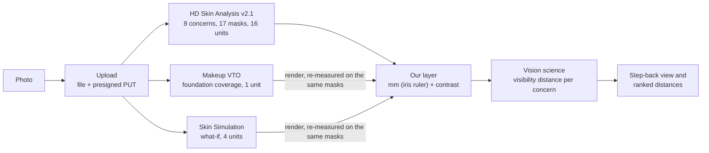

# How Arm's Length uses the YouCam API

This page lists every YouCam endpoint we call, what we send, what we use from the answer, what it costs, and what we
learned while building on it. The numbers come from real calls made on 2026-10-20 (61 units, all logged).
Where we only tested one face or one setting, we say so.

Contents: [1. The idea](#1-how-arms-length-uses-youcam) | [2. Endpoints](#2-every-endpoint-we-use) |
[3. The masks](#3-what-the-masks-actually-contain) | [4. Integration notes](#4-integration-notes-we-learned-the-hard-way) |
[5. Unit budget and safety](#5-unit-budget-and-safety) | [6. Replay and fixtures](#6-replay-and-fixtures)

## 1. How Arm's Length uses YouCam

Arm's Length answers one question: **from how far can another person see each thing in your skin analysis?**
YouCam HD Skin Analysis finds the features: spots, pores, wrinkles, acne, dark circles, eye bags and redness.
Our layer then measures each one in millimetres (the iris is the ruler) and in contrast, and applies published
vision science to turn that into a distance. Makeup Virtual Try-On (foundation) is the "least makeup" lever:
we render a few coverage levels and re-measure each one. Skin Simulation is the "what if": the same photo with a
concern turned down, measured the same way. No language model is involved. Same photo in, same numbers out.



What each part contributes:

| YouCam gives us | Our layer adds |
|---|---|
| Where each feature is (masks, aligned to the photo within about 1 px) | Size in mm (iris ruler), contrast against nearby skin in linear light |
| Scores per concern (`raw_score`, `ui_score`) | A distance per concern: the farthest an ideal observer could still see it |
| Foundation renders at chosen coverage | The lowest coverage that pushes a concern below a chosen distance, checked on the render |
| Skin Simulation renders | "If these faded by half, they would vanish beyond X" |

The model itself is described in `docs/MODEL.md`. This page covers the YouCam side only.

## 2. Every endpoint we use

Host: `https://yce-api-01.makeupar.com`. Auth: `Authorization: Bearer <API key>` (the V2 key) on every call except the
presigned PUT and result downloads. All calls are made from the server; the key never reaches the browser.
All code is in `lib/youcam/`.

| # | Method and path | What we send | What we use from the answer | Units | Code |
|---|---|---|---|---|---|
| 1 | `POST /s2s/v2.0/file` | `files: [{content_type, file_name, file_size}]` | `file_id`, and the presigned request (`method`, `url`, `headers`) | 0 | `client.ts` `upload` |
| 2 | `PUT <presigned URL>` | The photo bytes and the headers from step 1, minus `Content-Length`. No `Authorization` header | HTTP status only | 0 | `client.ts` `upload` |
| 3 | `POST /s2s/v2.1/task/skin-analysis`, then `GET /s2s/v2.1/task/skin-analysis/{task_id}` | `src_file_id`; `dst_actions`: `hd_acne`, `hd_age_spot`, `hd_pore`, `hd_wrinkle`, `hd_dark_circle`, `hd_redness`, `hd_eye_bag`, `hd_texture`; `format: "json"`. No `miniserver_args` (defaults). Budget fallback: the same eight without the `hd_` prefix (`dark_circle_v2` for dark circles) | `results.output[]`: per item `type`, `region`, `raw_score`, `ui_score`, `mask_urls[0]` (17 masks for 8 HD concerns); plus `all` (overall score), `skin_age` and `resize_image` (the analysed frame that the masks align to) | **16** HD (5-8 concerns) or **12** SD | `client.ts` `skinAnalysis`, `normalize.ts` |
| 4 | `POST /s2s/v2.0/task/makeup-vto`, then `GET /s2s/v2.0/task/makeup-vto/{task_id}` | `src_file_id`, `version: "1.0"`, `effects`. We always put `{category: "skin_smooth", skinSmoothStrength: 0, skinSmoothColorIntensity: 0}` first, then `{category: "foundation", palettes: [{color, colorIntensity: 50, glowIntensity: 0, coverageIntensity: 0-100}]}` | `results.url`: one PNG, which we re-measure with the analysis masks (shifted by one row, see section 4) | **1** | `client.ts` `makeup`, `render.ts` |
| 5 | `POST /s2s/v2.0/task/skin-simulation`, then `GET /s2s/v2.0/task/skin-simulation/{task_id}` | `src_file_id` and a strength from 0 to 1 per concern (we recorded `spots` and `redness` at 0.5). Zero strengths are not sent | `results.url`: one PNG, the same size as the input and pixel-aligned | **4** (1-4 concerns), 6 (5-10) | `client.ts` `simulate` |
| 6 | `GET /s2s/v1.0/client/credit` | Nothing. The Bearer key works here; the V1 client id and secret are not needed | `results[]` tokens: `amount_dec` (or `amount`) and `expiry`. We sum the unexpired ones to get the balance | 0 | `client.ts` `credit`, `budget.ts` |
| 7 | `GET /s2s/v1.0/client/credit/history?page_size=30` | `Content-Type: application/json` (required) | `results.history[]`: `action`, `timestamp`, `target_id`. We use it to check our own ledger against YouCam's | 0 | `scripts/spikes/free-history.ts` |
| 8 | `GET /s2s/v2.0/credit/feature-cost?page_size=20&starting_token=<next_token>` | Paging only | `result.skus[]` and `result.next_token`. 102 SKUs; the price table in `costs.ts` comes from here | 0 | `scripts/spikes/free-reads.ts`, `costs.ts` |

Notes on the table:

- **Polling** (steps 3 to 5) is free. We wait 1 s, poll every 1.5 s, and give up after 60 s. In our runs HD analysis had
  finished by about 7 s and a makeup render by about 8 s. The docs suggest 10 s; that would only add waiting.
- **Billing counts the concerns we ask for**, not the masks we get back. Eight HD concerns return 17 masks (pores and
  wrinkles expand into regions) and cost 16 units.
- **Price list** (from endpoint 8). Skin Analysis HD, 1-4 / 5-8 / 9-12 / 13-16 concerns: 12 / **16** / 20 / 22.
  SD: 9 / **12** / 14 / 16. Makeup VTO: **1**. Skin Simulation, 1-4 / 5-10 concerns: **4** / 6.
- **Steps 7 and 8 are used offline.** The running app reads the balance (step 6); the history and price list were read
  once, with free calls, to build and check the ledger and `costs.ts`.
- **Optional cleanup.** `POST /s2s/v2.0/task/delete` with `{task_ids: [...]}` is wired up but off by default
  (`YOUCAM_DELETE_TASKS=1` turns it on). We have not verified its request shape against the live service, so failures are ignored.
- **Not used:** the JS Camera Kit and the other YouCam analysis products. Capture quality checks and the iris ruler run
  on the device.

Our own routes sit on top of these, so the browser never talks to YouCam:

| Route | Does | Code |
|---|---|---|
| `POST /api/youcam/analysis` | Upload and analyse a photo, or return a recorded demo face. Returns scores and masks (as data URLs) | `app/api/youcam/analysis/route.ts` |
| `POST /api/youcam/makeup` | One foundation render for a given `fileRef` | `app/api/youcam/makeup/route.ts` |
| `POST /api/youcam/simulate` | One Skin Simulation render | `app/api/youcam/simulate/route.ts` |
| `GET /api/youcam/status` | Tells the UI whether live mode is open for this access code, and why not | `app/api/youcam/status/route.ts` |

## 3. What the masks actually contain

These are integration notes from two faces (p2b: 1080x1341, p3a: 1080x1575; both synthetic), plus one SD run on p2b.
The HD masks are drawn overlays, made to be shown on top of a photo. That is a good fit for a screen, and it means a
few steps are needed to use them as data. Here is what we found. Pixel counts are at 1080 px width.

| Concern | HD mask (what is drawn) | SD mask | HD vs SD, same photo |
|---|---|---|---|
| Age spots | A thin contour around each spot, with a transparent inside. Filling the contours gives real shapes: 89 spots on p2b, 194 on p3a; median 128 px (about 13 px, roughly 2 mm, across), up to 2,492 px | Soft filled blobs: 165 on p2b, many small fragments (10th percentile 8 px) | 85 of 89 HD spots (96%) sit within 8 px of an SD blob |
| Wrinkles | Thin polylines, median width 3 px; 229 lines on p2b, 242 on p3a. Six region masks (forehead, glabellar, crowfeet, periocular, nasolabial, marionette) show the same lines with a region window cut out of the dark layer | Thick strokes, median width 12 px (90th percentile 26); no region masks | Width and edge position differ, so the line widths we measure come from HD |
| Pores | Round dots of one fixed size (smallest 7x7 px): 201 on p2b, 184 on p3a. A location per pore, not a pore size. Region masks (forehead, nose, cheek) repeat the dots | 258 tiny marks, about 3 px across, whole face only | Different detections: 52 of 201 HD dots lie within 8 px of an SD mark (111 within 20 px) |
| Acne | Rings of one fixed size, 17x17 px: 15 on p2b, 7 on p3a. Location only | 11 rings, about 12 px | 3 of 15 HD rings lie within 8 px of an SD ring |
| Dark circles | A graded, soft-edged ring around each eye (alpha 1-149 on p2b), 26,000-29,000 px each. It reaches the upper lid and outer corner too | Identical | IoU 1.00, same score (60.71) |
| Eye bags | A flat fill with graded opacity (alpha 1-164): two regions of about 11,000 px, plus a dashed outline that breaks into 38 small pieces | Same two regions, no dashes, about 8% more area | IoU 0.85 |
| Redness | The dark layer has soft cut-outs where redness is called: four zones on p3a (146,509 px for cheeks and nose bridge, 26,189 chin, 19,008 forehead, 10,160 between the brows). Cut-out depth tracks the photo's red-green (a*) value, r = 0.59. **Empty on p2b** (deep brown skin, score 100) | Fully transparent on p2b; not run on p3a | Not compared on a face that has redness |
| Texture | A face window (forehead and both cheeks, about 17-21% of the image) plus 570-1,120 small sample dots | Sample dots only (568) | We use the window only, as a patch of skin for reference measurements |

More detail behind the table:

- **The modal-alpha rule.** Most HD masks carry a baked-in dark layer (RGB 61,61,61) at a fixed opacity per concern,
  covering 97 to 100% of the image: alpha 102 for pores (and the pore, wrinkle and texture region masks), 92 for acne,
  51 for age spots and redness. The information is in whatever differs from that layer: drawn marks and transparent
  cut-outs. So "alpha above 0" gives one blob the size of the image. We take the **most common alpha as the
  background** and count any pixel that differs as foreground. The dark circle, eye bag and whole-face wrinkle masks, and all
  SD masks, have a transparent background (most common alpha 0), and the same rule gives the right answer there.
  We used the default output. The documented `miniserver_args` (for example `enable_dark_background_hd_pore`) may give
  cleaner layers; we did not test them.
- **Alignment with the input.** Every mask is exactly the size of the input (nothing was resized, because the long side was
  under 2,560 px). Sliding the age-spot masks over the photo, the spot-to-surround contrast peaks at an offset of
  (0, 0) px on p2b and (+1, 0) on p3a. We take masks as aligned within about 1 px and use them as they come.
  If the long side exceeds 2,560 px, the API resizes; `resize_image` tells you the frame the masks live in.
- **Pores and acne are point features.** They give locations, so size and contrast come from the photo around each marker.
  At roughly 0.2 mm per pixel a real pore is about one pixel or less, and the photo contrast at the dots is low
  (median absolute Weber contrast 0.03-0.07). We read the markers as "something is here", and let the contrast
  measurement decide whether it can be seen.
- **Scores.** Dark circle, eye bag, age spot and redness scores are identical in HD and SD. Pore (HD whole-face 16.4 raw, SD 59.5), texture (19.7 vs 7.6),
  acne (75.2 vs 83.4) and wrinkle (59.7 vs 65.4) differ, so the two engines are not interchangeable for those. `ui_score` looks
  like a fixed, concern-specific remap of `raw_score` (raw 0 gives ui 30, raw 100 gives ui 99).
- **Zeros can be right.** `hd_pore_forehead` scored 0 on p2b while the forehead holds nearly all the marked pores, so the
  score and the mask agree. An empty redness mask means there is nothing to report for redness.
- **Beard stubble.** On a face with stubble, the HD wrinkle mask also draws short lines along the jaw and chin. They are thin
  and short, so their visibility distance comes out low, and we list it as a known limit.
- **Which engine we use.** HD, everywhere: thin wrinkle lines and true spot outlines are what the distance claim rests on.
  SD (12 units instead of 16) is the budget fallback for live sessions. Under SD we drop pore and acne distances, because
  those detections mostly disagree with HD.
- **Limits of this comparison.** One analysis per image, on two faces. We did not test repeatability (the same image twice),
  and neither engine is checked against ground truth.

## 4. Integration notes we learned the hard way

Tips for other developers. Each one cost us a few units or an afternoon.

1. **Never auto-retry a task-submit POST.** On the seventh submit of a batch, the connection reset (`ECONNRESET`) after the
   server had accepted and charged the task. The response with the task id was lost. A retry would have charged twice.
   Our client retries only calls that are free and repeatable (GETs, the upload, the presigned PUT, and an explicit HTTP 429).
   For a submit that ends in a network error or a 5xx, it reports "may have been charged" to the ledger and asks the user
   to try again. The lost task id was recovered from the credit history. YouCam debits at submit time (history timestamps fall in the
   same second as the submit), so count an unknown submit result as a charge.
2. **Parse ids bigint-safe, and expect scores that look like strings.** Some ids in the credit endpoints exceed 2^53
   (18 digits in the credit response). A bigint-safe JSON parser that stores big values as strings also turns any number literal longer
   than 15 characters into a string, so `raw_score` arrives as `"52.43487358093262"` in some items and `100` in others.
   The API itself sends numbers. Coerce scores with `Number()` after parsing (`normalize.ts`).
3. **Makeup VTO output is shifted down by one row.** For a 1080x1341 input the render is 1080x1340. It is a black first row
   followed by input rows 0 to 1338, so `out(x, y+1) = in(x, y)`. It is a pure translation: we measured 0.99 px vertical and
   0.00 px horizontal, with no scale drift. It stays the same with `skin_smooth` at 0 and no makeup. We
   do not know why (our guess is a crop to an even height). Ignoring it costs little for big regions and matters for 1-3 px
   features. `render.ts` returns `offset: {dx: 0, dy: 1}` for renders that match the frame, and `{0, 0}` when the size
   differs by more than 2 px (VTO accepts long sides up to 1920 px, so a larger photo comes back rescaled and needs
   scaling instead). Never sample row 0. Skin Simulation output is pixel-aligned with no offset.
4. **Send `skin_smooth` at 0 to get an honest render.** Without a `skin_smooth` effect, the docs say a default strength of
   50 is applied. We saw smoothing plus a global brightening of about +23% in linear luminance, background included.
   With `{category: "skin_smooth", skinSmoothStrength: 0, skinSmoothColorIntensity: 0}` first in `effects`:
   - a render with no makeup is **bit-identical to the input** (largest difference 0 over all 1080x1340x3 values, after the shift), so a
     "coverage 0" baseline needs no paid call;
   - every makeup effect is local, with no global tone change;
   - the brightening is a switch, not a ramp: strength 100 gave the same +23.6% as the default 50.
   Smoothing also made dark circles slightly more visible (contrast 0.514, 0.535, 0.553 at smoothing 0, default and 100).
5. **Foundation `coverageIntensity` is a real lever; concealer `coverageLevel` was not, in our tests.** Setup: one face, one
   cheek-matched shade, `skin_smooth` 0.
   - Foundation, spot contrast (median absolute Weber): 0.196 with no makeup, 0.138 at coverage 50, 0.107 at 100. That is
     -30% and -45%, concave: most of the effect is there by 50. Acne contrast fell 16% and 27%.
   - Concealer `coverageLevel` 20, 50 and 90 differed by 0.03/255 on average. `colorUnderEyeIntensity` at 10, 50 and 90 moved
     dark-circle contrast by 0.4% in total, and `colorIntensity` 50 to 90 changed nothing measurable. Concealer behaved like an
     on/off step.
   - Dark circles did not respond to any makeup parameter we tried. The best cases were a 6% drop in contrast with foundation
     (an on/off step that did not grow with coverage) and 9% with concealer (the shade darkened the skin below the eye, so
     the circle did not get lighter). Dark-circle what-ifs therefore go through the Skin Simulation `dark_circle` strength,
     which is documented but not yet tested by us.
   - A lighter concealer shade is the one input we did not test.
6. **`feature-cost` is paginated.** `page_size` is at most 20, and the next page needs `starting_token` set to the previous
   `next_token`. The first page shows only image and hair tools; the skin prices are on later pages (102 SKUs in all).
7. **Credit history needs a `Content-Type: application/json` header,** even on a GET, or it answers HTTP 415. Its `target_id`
   is `<task_id>:<12-digit suffix>`, not the bare task id: match with `startsWith`. Both credit endpoints work with the V2
   Bearer key.
8. **Result URLs last 2 hours** (presigned, `X-Amz-Expires=7200`). We download masks and renders on the server right after
   the task succeeds. A free re-poll of the same task returned fresh URLs. Do not send your `Authorization` header to the
   presigned URL.
9. **Small things that saved us time:**
   - Leave `Content-Length` out of the headers you replay on the presigned PUT; the HTTP client sets it from the body.
   - The VTO result URL ends in `.jpg`, but the file is a PNG with an alpha channel (fully opaque). Check the file's first bytes.
   - A rejected submit (HTTP 400) creates no task and costs nothing. We check the size ourselves first (HD needs a short
     side of at least 1080 px; the face should fill more than 60% of the width), so a refusal is free.
   - We saw no rate-limit headers and no HTTP 4xx or 5xx answers across the 61 units (our one failure was a dropped
     connection). The docs state about 250 requests per 300 s per IP, and our client backs off on 429.
   - Error codes are not always in the documented list, so `errors.ts` maps the ones we know to plain sentences and gives
     any unknown code a safe retry message.

## 5. Unit budget and safety

The project has **1,000 free units in total**. They cover building, the demo video and every judge session until judging ends
on 2026-11-20. The units expire on 2027-01-18. The rules ask that the app stays testable and free through judging, so
the plan keeps most of the units for that.

**Spend so far** (project ledger, 2026-10-20; the balance was confirmed with `GET /s2s/v1.0/client/credit`):

| Bucket | Planned | Spent | What it bought |
|---|---|---|---|
| Phase 0 spike | 55 | 53 | 2 HD analyses (32), 1 SD analysis (12), 5 makeup renders (5), 1 simulation (4) |
| Reserve | 335 | 8 | 8 makeup renders to find which makeup parameters change anything (section 4, note 5) |
| Demo personas | 90 | 0 so far | Recording more demo faces (analysis, foundation coverage grid, what-ifs) |
| Integration checks | 40 | 0 | Two full live sessions |
| Deployed smoke tests | 40 | 0 | Two live sessions on the deployed site |
| Demo video | 40 | 0 | One live session on a phone and one on desktop |
| Judges' live sessions | 400 | 0 | About 20 sessions of about 20 units |
| **Total** | **1,000** | **61** | **Balance 939** |

Demo-face recording was still in progress when this was written, so the "Demo personas" row is not final. The totals are
updated here before submission.

Every paid call goes through one guard (`lib/youcam/budget.ts`, used by `lib/youcam/service.ts`):

- **Demo faces are free and always on.** A request for a demo face is answered from recorded files (section 6) and never reaches
  YouCam. No code and no key are needed.
- **Live mode needs an access code.** Judges get one in the testing instructions. The code travels in the `x-access-code`
  header and is compared in constant time against `LIVE_ACCESS_CODES`. Only a 12-character hash of it is logged.
- **Daily caps per code:** 3 live analyses (`LIVE_DAILY_CAP`) and a separate, larger cap for renders
  (`LIVE_RENDER_DAILY_CAP`; the example config uses 12). A slot is handed back if a call fails before any unit is spent.
  Caps are held in memory per server instance, so they are a best-effort limit; the floor and the kill switch below are the firm ones.
- **Balance floor.** Live mode refuses a call if the balance after it would be at or below `UNIT_FLOOR` (default **100**).
  The balance is read from `GET /s2s/v1.0/client/credit`, cached for 60 s, and lowered locally after every spend so a burst
  of requests cannot overshoot. If the balance cannot be read, live mode stays closed.
- **Kill switch.** `KILL_SWITCH=1` refuses every paid call at once.
- **Replay mode.** `YOUCAM_MODE=replay`, or no API key, makes live calls impossible. The guard then reports it like a kill switch.
- **Checks before spending.** Wrong file type, over 10 MB, or an HD photo with a short side under 1080 px is refused before
  anything is uploaded.
- **Ledger.** Each paid call writes one JSON line with the action, units, access-code hash, timestamp and a `maybe` flag for
  submits whose outcome is unknown. The balance is cross-checked with the credit and credit-history endpoints.
- **Cheaper fallback.** `YOUCAM_ENGINE=sd` switches live analysis to the 12-unit engine.
- Keys are read from the server environment only. Nothing in `.env` is committed, logged or sent to the browser.

## 6. Replay and fixtures

The demo runs with **no keys and no network**. Everything below is real YouCam output, recorded once, replayed on request.

**What is recorded** (`fixtures/youcam/`, about 15.5 MB, see its `README.md`):

| Face | Photo | Recorded |
|---|---|---|
| p2b | Synthetic face, deep brown skin, 1080x1341 | HD analysis (JSON and 17 masks), SD analysis (8 masks), 5 makeup renders (concealer coverage 20, 50, 90; foundation coverage 30, 80), each with its request |
| p3a | Synthetic face, 1080x1575 | HD analysis (JSON and 17 masks), 1 Skin Simulation render (spots 0.5, redness 0.5) with its request |

- The photos are **synthetic faces made with an AI image tool**. Nobody real is shown, so there is nothing to consent to or license.
- The JSON and images are the unedited API output. Removed on purpose: task ids, file ids, signed URLs, storage prefixes, keys.
  Each URL was replaced by a path inside the face's folder.
- More demo faces are added the same way: one folder per face with the same layout.

**How replay works** (`lib/youcam/replay.ts`):

1. A request that names a demo face (`persona`) skips the live path entirely. `analysis.hd.json` goes through the same
   `normalizeAnalysis` function as a live response, and the masks are read from disk as data URLs. The response says
   `source: "replay"` and `unitsCharged: 0`.
2. A makeup or simulation request on a demo face gets the **closest recorded render**: same category first, then the
   nearest parameter value (foundation by `coverageIntensity`). If nothing was recorded for that change, the user sees a plain
   message instead of a made-up image.
3. Renders get the same alignment offset as live ones (for example `dy: 1` for makeup), so the measurement code cannot tell the difference.

**Tests never call YouCam.** Unit tests in `lib/youcam/` use a fake `fetch` and these fixtures: request shapes, the retry rules, the
guard, the one-row shift and the replay choice are all checked offline. To run the app on recorded data:

```bash
cp .env.example .env     # leave YOUCAM_API_KEY empty; YOUCAM_MODE=replay is the default
npm run dev              # demo faces work with no further setup
```
