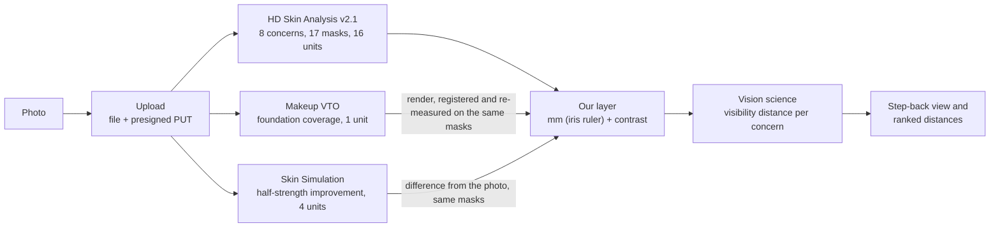

# How Arm's Length uses the YouCam API

This page lists every YouCam endpoint we call, what we send, what we use from the answer, what it costs, and what we
learned while building on it. The numbers come from real calls, all logged: 184 units so far (the first 61, on two
faces, are behind sections 3 and 4; the next 98 recorded two more faces, a makeup grid and the Skin Simulation
renders of section 7; the last 25 were the first live session through the running app, section 5). Where we only
tested one face or one setting, we say so.

Contents: [1. The idea](#1-how-arms-length-uses-youcam) | [2. Endpoints](#2-every-endpoint-we-use) |
[3. The masks](#3-what-the-masks-actually-contain) | [4. Integration notes](#4-integration-notes-we-learned-the-hard-way) |
[5. Unit budget and safety](#5-unit-budget-and-safety) | [6. Replay and fixtures](#6-replay-and-fixtures) |
[7. Skin Simulation: two uses](#7-skin-simulation-two-uses) | [8. The drop-in layer](#8-the-drop-in-layer-post-apivisibility)

## 1. How Arm's Length uses YouCam

Arm's Length answers one question: **from how far can another person see each thing in your skin analysis?**
YouCam HD Skin Analysis finds the features: spots, pores, wrinkles, acne, dark circles, eye bags and redness.
Our layer then measures each one in millimetres (the iris is the ruler) and in contrast, and applies published
vision science to turn that into a distance. Makeup Virtual Try-On (foundation) is "the lightest touch" lever:
we render a few coverage levels and re-measure each one. Skin Simulation is the "what if": the same photo with a
concern simulated at half strength, and the difference between the two measured the same way ("Worth it?", section 7). Our
layer also works on any YouCam Skin Analysis result you already have, through one drop-in route (section 8). No
language model is involved. Same photo in, same numbers out.



What each part contributes:

| YouCam gives us | Our layer adds |
|---|---|
| Where each feature is (masks, aligned to the photo within about 1 px) | Size in mm (iris ruler), contrast against nearby skin in linear light |
| Scores per concern (`raw_score`, `ui_score`) | A distance per concern: the farthest an ideal observer could still see it |
| Foundation renders at chosen coverage | The lowest coverage that pushes a concern below a chosen distance, checked on the render |
| Skin Simulation renders | "Worth it?": the farthest distance at which the change from a half-strength improvement stays detectable |

The model itself is described in `docs/MODEL.md`. This page covers the YouCam side only.

## 2. Every endpoint we use

Host: `https://yce-api-01.makeupar.com`. Auth: `Authorization: Bearer <API key>` (the V2 key) on every call except the
presigned PUT and result downloads. All calls are made from the server; the key never reaches the browser.
All code is in `lib/youcam/`.

| # | Method and path | What we send | What we use from the answer | Units | Code |
|---|---|---|---|---|---|
| 1 | `POST /s2s/v2.0/file` | `files: [{content_type, file_name, file_size}]` | `file_id`, and the presigned request (`method`, `url`, `headers`) | 0 | `client.ts` `upload` |
| 2 | `PUT <presigned URL>` | The photo bytes and the headers from step 1, minus `Content-Length`. No `Authorization` header | HTTP status only | 0 | `client.ts` `upload` |
| 3 | `POST /s2s/v2.1/task/skin-analysis`, then `GET /s2s/v2.1/task/skin-analysis/{task_id}` | `src_file_id`; `dst_actions`: `hd_acne`, `hd_age_spot`, `hd_pore`, `hd_wrinkle`, `hd_dark_circle`, `hd_redness`, `hd_eye_bag`, `hd_texture`; `format: "json"`. No `miniserver_args` (defaults). Budget fallback: the same eight without the `hd_` prefix (`dark_circle_v2` for dark circles) | `results.output[]`: per item `type`, `region`, `raw_score`, `ui_score`, `mask_urls[0]` (17 masks for 8 HD concerns); plus `all` (overall score), `skin_age` and `resize_image` (the analysed frame that the masks align to) | **16** HD (5-8 concerns) or **12** SD | `client.ts` `skinAnalysis`, `normalize.ts` |
| 4 | `POST /s2s/v2.0/task/makeup-vto`, then `GET /s2s/v2.0/task/makeup-vto/{task_id}` | `src_file_id`, `version: "1.0"`, `effects`. We always put `{category: "skin_smooth", skinSmoothStrength: 0, skinSmoothColorIntensity: 0}` first, then `{category: "foundation", palettes: [{color, colorIntensity: 50, glowIntensity: 0, coverageIntensity: 0-100}]}` | `results.url`: one PNG, which we register to the photo (the shift differs per photo, see section 4, note 3) and re-measure with the analysis masks | **1** | `client.ts` `makeup`, `render.ts` |
| 5 | `POST /s2s/v2.0/task/skin-simulation`, then `GET /s2s/v2.0/task/skin-simulation/{task_id}` | `src_file_id` and a strength from 0 to 1 per concern. Recorded: `dark_circle`, `eye_bags`, `wrinkle`, `redness` (one call) and `spots`, `pores`, `acne` (one call) at 0.5; the same four at 1.0 once per face. Zero strengths are not sent | `results.url`: one PNG, the same size as the input and pixel-aligned | **4** (1-4 concerns), 6 (5-10) | `client.ts` `simulate` |
| 6 | `GET /s2s/v1.0/client/credit` | Nothing. The Bearer key works here; the V1 client id and secret are not needed | `results[]` tokens: `amount_dec` (or `amount`) and `expiry`. We sum the unexpired ones to get the balance | 0 | `client.ts` `credit`, `budget.ts` |
| 7 | `GET /s2s/v1.0/client/credit/history?page_size=30` | `Content-Type: application/json` (required) | `results.history[]`: `action`, `timestamp`, `target_id`. We use it to check our own ledger against YouCam's | 0 | `scripts/spikes/free-history.ts` |
| 8 | `GET /s2s/v2.0/credit/feature-cost?page_size=20&starting_token=<next_token>` | Paging only | `result.skus[]` and `result.next_token`. 102 SKUs; the price table in `costs.ts` comes from here | 0 | `scripts/spikes/free-reads.ts`, `costs.ts` |
| 9 | `POST /s2s/v2.0/task/delete` | `{"task_id": "<id>"}`, one POST per finished task | HTTP status only. 200 `{"status":200}`; afterwards the task answers 400 `InvalidTaskId` and its result URL 404 | 0 | `client.ts` `deleteTask`, `service.ts` `cleanup` |

Notes on the table:

- **Polling** (steps 3 to 5) is free. We wait 1 s, poll every 1.5 s, and give up after 60 s. In our runs HD analysis had
  finished by about 7 s and a makeup render by about 8 s. The docs suggest 10 s; that would only add waiting.
- **Billing counts the concerns we ask for**, not the masks we get back. Eight HD concerns return 17 masks (pores and
  wrinkles expand into regions) and cost 16 units.
- **Price list** (from endpoint 8). Skin Analysis HD, 1-4 / 5-8 / 9-12 / 13-16 concerns: 12 / **16** / 20 / 22.
  SD: 9 / **12** / 14 / 16. Makeup VTO: **1**. Skin Simulation, 1-4 / 5-10 concerns: **4** / 6.
- **Steps 7 and 8 are used offline.** The running app reads the balance (step 6); the history and price list were read
  once, with free calls, to build and check the ledger and `costs.ts`.
- **Cleanup (step 9, verified).** `POST /s2s/v2.0/task/delete` takes `{"task_id": "<id>"}`, one task per call, and is free.
  Our first client sent `{task_ids: [...]}`, which answers 400 `InvalidParameters`, so the call never worked until we read
  the live reference and fixed the body. Analysis and makeup tasks delete. A Skin Simulation task does not: it answers 400
  `OperationInvalid` although its status is `success`. We delete once, when the visitor leaves the page (section 4, note 10).
- **Not used:** the JS Camera Kit and the other YouCam analysis products. Capture quality checks and the iris ruler run
  on the device.

Our own routes sit on top of these, so the browser never talks to YouCam:

| Route | Does | Code |
|---|---|---|
| `POST /api/youcam/analysis` | Upload and analyse a photo, or return a recorded demo face. Returns scores and masks (as data URLs) | `app/api/youcam/analysis/route.ts` |
| `POST /api/youcam/makeup` | One foundation render for a given `fileRef` | `app/api/youcam/makeup/route.ts` |
| `POST /api/youcam/simulate` | One Skin Simulation render | `app/api/youcam/simulate/route.ts` |
| `GET /api/youcam/status` | Tells the UI whether live mode is open for this caller (own key, access code, or open deployment), and why not. With an own key it checks the key with one free `credit()` call | `app/api/youcam/status/route.ts` |
| `POST /api/youcam/cleanup` | Deletes the YouCam tasks a live session created (with the visitor's own key for an own-key session): signed task tokens in, a count of deleted and failed out. The browser calls it when the visitor leaves the page (section 4, note 10) | `app/api/youcam/cleanup/route.ts` |
| `POST /api/visibility` | The drop-in layer: a YouCam Skin Analysis result you already have plus its photo in, a visibility report out. Calls no YouCam endpoint, spends no units (section 8) | `app/api/visibility/route.ts` |

## 3. What the masks actually contain

These are integration notes from two faces (p2b: 1080x1341, p3a: 1080x1575; both synthetic), plus one SD run on p2b.
The HD masks are drawn overlays, made to be shown on top of a photo. That is a good fit for a screen, and it means a
few steps are needed to use them as data. Here is what we found. Pixel counts are at 1080 px width.

| Concern | HD mask (what is drawn) | SD mask | HD vs SD, same photo |
|---|---|---|---|
| Age spots | A thin contour around each spot, with a transparent inside. Filling the contours gives real shapes: 89 spots on p2b, 194 on p3a; median 128 px (about 13 px, roughly 2 mm, across), up to 2,492 px | Soft filled blobs: 165 on p2b, many small fragments (10th percentile 8 px) | 85 of 89 HD spots (96%) sit within 8 px of an SD blob |
| Wrinkles | Thin polylines, median width 3 px; 229 lines on p2b, 242 on p3a. Six region masks (forehead, glabellar, crowfeet, periocular, nasolabial, marionette) show the same lines with a region window cut out of the dark layer | Thick strokes, median width 12 px (90th percentile 26); no region masks | Width and edge position differ, so the line widths we measure come from HD |
| Pores | Round dots of one fixed size (smallest 7x7 px): 201 on p2b, 184 on p3a. A location per pore, not a pore size. Region masks (forehead, nose, cheek) repeat the dots | 258 tiny marks, about 3 px across, whole face only | Different detections: 52 of 201 HD dots lie within 8 px of an SD mark (111 within 20 px) |
| Acne | Rings of one fixed size, 17x17 px: 15 on p2b, 7 on p3a. Location only | 11 rings, about 12 px | 3 of 15 HD rings lie within 8 px of an SD ring |
| Dark circles | A graded, soft-edged ring around each eye (alpha 1-149 on p2b), 26,000-29,000 px each. It reaches the upper lid and outer corner too | Identical | IoU 1.00, same score (60.71) |
| Eye bags | A flat fill with graded opacity (alpha 1-164): two regions of about 11,000 px, plus a dashed outline that breaks into 38 small pieces | Same two regions, no dashes, about 8% more area | IoU 0.85 |
| Redness | The dark layer has soft cut-outs where redness is called: four zones on p3a (146,509 px for cheeks and nose bridge, 26,189 chin, 19,008 forehead, 10,160 between the brows). Cut-out depth tracks the photo's red-green (a*) value, r = 0.59. **Empty on p2b** (deep brown skin, score 100) | Fully transparent on p2b; not run on p3a | Not compared on a face that has redness |
| Texture | A face window (forehead and both cheeks, about 17-21% of the image) plus 570-1,120 small sample dots | Sample dots only (568) | We use the window only, as a patch of skin for reference measurements |

More detail behind the table:

- **The modal-alpha rule.** Most HD masks carry a baked-in dark layer (RGB 61,61,61) at a fixed opacity per concern,
  covering 97 to 100% of the image: alpha 102 for pores (and the pore, wrinkle and texture region masks), 92 for acne,
  51 for age spots and redness. The information is in whatever differs from that layer: drawn marks and transparent
  cut-outs. So "alpha above 0" gives one blob the size of the image. We take the **most common alpha as the
  background** and count any pixel that differs as foreground. The dark circle, eye bag and whole-face wrinkle masks, and all
  SD masks, have a transparent background (most common alpha 0), and the same rule gives the right answer there.
  We used the default output. The documented `miniserver_args` (for example `enable_dark_background_hd_pore`) may give
  cleaner layers; we did not test them.
- **Alignment with the input.** Every mask is exactly the size of the input (nothing was resized, because the long side was
  under 2,560 px). Sliding the age-spot masks over the photo, the spot-to-surround contrast peaks at an offset of
  (0, 0) px on p2b and (+1, 0) on p3a. We take masks as aligned within about 1 px and use them as they come.
  If the long side exceeds 2,560 px, the API resizes; `resize_image` tells you the frame the masks live in.
- **Pores and acne are point features.** They give locations, so size and contrast come from the photo around each marker.
  At roughly 0.2 mm per pixel a real pore is about one pixel or less, and the photo contrast at the dots is low
  (median absolute Weber contrast 0.03-0.07). We read the markers as "something is here", and let the contrast
  measurement decide whether it can be seen.
- **Scores.** Dark circle, eye bag, age spot and redness scores are identical in HD and SD. Pore (HD whole-face 16.4 raw, SD 59.5), texture (19.7 vs 7.6),
  acne (75.2 vs 83.4) and wrinkle (59.7 vs 65.4) differ, so the two engines are not interchangeable for those. `ui_score` looks
  like a fixed, concern-specific remap of `raw_score` (raw 0 gives ui 30, raw 100 gives ui 99).
- **Zeros can be right.** `hd_pore_forehead` scored 0 on p2b while the forehead holds nearly all the marked pores, so the
  score and the mask agree. An empty redness mask means there is nothing to report for redness.
- **Beard stubble.** On a face with stubble, the HD wrinkle mask also draws short lines along the jaw and chin. They are thin
  and short, so their visibility distance comes out low, and we list it as a known limit.
- **Which engine we use.** HD, everywhere: thin wrinkle lines and true spot outlines are what the distance claim rests on.
  SD (12 units instead of 16) is the budget fallback for live sessions. Under SD we drop pore and acne distances, because
  those detections mostly disagree with HD.
- **Limits of this comparison.** One analysis per image, on two faces. We did not test repeatability (the same image twice),
  and neither engine is checked against ground truth.

## 4. Integration notes we learned the hard way

Tips for other developers. Each one cost us a few units or an afternoon.

1. **Never auto-retry a task-submit POST.** On the seventh submit of a batch, the connection reset (`ECONNRESET`) after the
   server had accepted and charged the task. The response with the task id was lost. A retry would have charged twice.
   Our client retries only calls that are free and repeatable (GETs, the upload, the presigned PUT, and an explicit HTTP 429).
   For a submit that ends in a network error or a 5xx, it reports "may have been charged" to the ledger and asks the user
   to try again. The lost task id was recovered from the credit history. YouCam debits at submit time (history timestamps fall in the
   same second as the submit), so count an unknown submit result as a charge.
2. **Parse ids bigint-safe, and expect scores that look like strings.** Some ids in the credit endpoints exceed 2^53
   (18 digits in the credit response). A bigint-safe JSON parser that stores big values as strings also turns any number literal longer
   than 15 characters into a string, so `raw_score` arrives as `"52.43487358093262"` in some items and `100` in others.
   The API itself sends numbers. Coerce scores with `Number()` after parsing (`normalize.ts`).
3. **Makeup VTO output is shifted, and the shift differs per photo. Register every render.** On the first face (p2b,
   1080x1341) the render is 1080x1340: a black first row followed by input rows 0 to 1338, so `out(x, y+1) = in(x, y)`, a
   pure translation (0.99 px vertical, 0.00 px horizontal, no scale drift), unchanged with `skin_smooth` at 0 and no makeup.
   We first took that for a rule. Recording more faces showed it is not:

   | Face | Input | Render | Shift (`dx`, `dy`) | Padding |
   |---|---|---|---|---|
   | p2b | 1080x1341 | 1080x1340 | (0, +1) | Black first row |
   | p3a | 1080x1575 | 1078x1576 | (-3, 0) | Black last row and last column |
   | p1a | 1080x1610 | 1080x1610 | (0, 0) | None |

   Within one face every render has the same geometry (patch-wise spread 0.03 to 0.15 px, correlation at least 0.86), but the
   output size alone does not give the shift, so a size rule is wrong for p3a and p1a. So the offset is measured per render:
   `lib/coverage/register.ts` finds it by cross-correlation against the photo (whole pixels, within 6 px), and
   `render.ts`'s guess from the sizes (`{0, 1}` for a makeup render in the same frame, `{0, 0}` for a simulation, `{0, 0}`
   when the size differs by more than 2 px, because VTO accepts long sides up to 1920 px and a larger photo comes back
   rescaled) is only the fallback for a photo with too little texture to register. Never sample the black padding.
   Skin Simulation output was pixel-aligned on all four faces (shift within 0.06 px, 0.15 px on p3a), and goes through the
   same registration.
4. **Send `skin_smooth` at 0 to get an honest render.** Without a `skin_smooth` effect, the docs say a default strength of
   50 is applied. We saw smoothing plus a global brightening of about +23% in linear luminance, background included.
   With `{category: "skin_smooth", skinSmoothStrength: 0, skinSmoothColorIntensity: 0}` first in `effects`:
   - a render with no makeup is **bit-identical to the input** (largest difference 0 over all 1080x1340x3 values, after the shift), so a
     "coverage 0" baseline needs no paid call;
   - every makeup effect is local, with no global tone change;
   - the brightening is a switch, not a ramp: strength 100 gave the same +23.6% as the default 50.
   Smoothing also made dark circles slightly more visible (contrast 0.514, 0.535, 0.553 at smoothing 0, default and 100).
5. **Foundation `coverageIntensity` is a real lever; concealer `coverageLevel` was not, in our tests.** Setup: one face, one
   cheek-matched shade, `skin_smooth` 0.
   - Foundation, spot contrast (median absolute Weber): 0.196 with no makeup, 0.138 at coverage 50, 0.107 at 100. That is
     -30% and -45%, concave: most of the effect is there by 50. Acne contrast fell 16% and 27%.
   - Concealer `coverageLevel` 20, 50 and 90 differed by 0.03/255 on average. `colorUnderEyeIntensity` at 10, 50 and 90 moved
     dark-circle contrast by 0.4% in total, and `colorIntensity` 50 to 90 changed nothing measurable. Concealer behaved like an
     on/off step.
   - Dark circles did not respond to any makeup parameter we tried. The best cases were a 6% drop in contrast with foundation
     (an on/off step that did not grow with coverage) and 9% with concealer (the shade darkened the skin below the eye, so
     the circle did not get lighter). Dark-circle what-ifs therefore go through the Skin Simulation `dark_circle` strength,
     which we have since recorded on four faces at 0.5 and 1.0 (section 7).
   - A lighter concealer shade is the one input we did not test.
6. **`feature-cost` is paginated.** `page_size` is at most 20, and the next page needs `starting_token` set to the previous
   `next_token`. The first page shows only image and hair tools; the skin prices are on later pages (102 SKUs in all).
7. **Credit history needs a `Content-Type: application/json` header,** even on a GET, or it answers HTTP 415. Its `target_id`
   is `<task_id>:<12-digit suffix>`, not the bare task id: match with `startsWith`. Both credit endpoints work with the V2
   Bearer key.
8. **Result URLs last 2 hours** (presigned, `X-Amz-Expires=7200`). We download masks and renders on the server right after
   the task succeeds. A free re-poll of the same task returned fresh URLs. Do not send your `Authorization` header to the
   presigned URL.
9. **Small things that saved us time:**
   - Leave `Content-Length` out of the headers you replay on the presigned PUT; the HTTP client sets it from the body.
   - The VTO result URL ends in `.jpg`, but the file is a PNG with an alpha channel (fully opaque). Check the file's first bytes.
   - A rejected submit (HTTP 400) creates no task and costs nothing. We check the size ourselves first (HD needs a short
     side of at least 1080 px; the face should fill more than 60% of the width), so a refusal is free.
   - We saw no rate-limit headers and no HTTP 4xx or 5xx answers across the 61 units (our one failure was a dropped
     connection). The docs state about 250 requests per 300 s per IP, and our client backs off on 429.
   - Tip: handle error codes as an open list. `errors.ts` maps the ones we know to plain sentences and gives
     any other code a safe retry message.
10. **Deleting a task: the body is `{task_id}`, and Skin Simulation refuses.** Verified against the live service on
    2026-10-20, and again in our first live session on 2026-10-21:
    - `POST /s2s/v2.0/task/delete` with `{"task_id": "<id>"}` returns 200 `{"status":200}` in about 2.2 s and costs nothing
      (the credit balance did not move). Afterwards the task's status answers 400 `InvalidTaskId`, the same as for an
      expired task, and its mask URL answers 404: the output is gone from storage. A sibling task on the same uploaded file
      was untouched, so outputs are deleted per task.
    - The body `{task_ids: [...]}` (our first guess) answers 400 `InvalidParameters` and changes nothing. Our client swallowed
      the error, so it looked fine. Log delete failures.
    - Only a finished task can be deleted (`OperationInvalid` otherwise). `OperationNotSupport` means the id is not the one
      the run endpoint returned; `InvalidTaskId` means malformed, unknown or already deleted.
    - **Analysis and makeup tasks delete. A Skin Simulation task does not:** it answers 400 `OperationInvalid` although its
      status is `success` (seen in the first live session). Its output stays under YouCam's own retention, and we say so in
      the privacy notice.
    - YouCam's changelog says a delete removes "all associated input files and generated outputs". We verified the outputs,
      not the input file. That wording is why we delete **once, at the end of the session** and not after each call: a makeup
      or simulation render reuses the uploaded file of the analysis.
    - **What ships.** Each live call returns the tasks it created as signed tokens (an HMAC of the task id, keyed with the
      API key), so a visitor can only delete tasks this server made. On `pagehide` the browser sends the tokens with
      `navigator.sendBeacon` to `POST /api/youcam/cleanup` (a keepalive `fetch` if the beacon is refused), and the server
      deletes the tasks in parallel. `YOUCAM_DELETE_TASKS` is on unless set to `0`. It is best effort: a lost beacon or a
      failed call leaves the tasks to YouCam's retention. Demo faces create no tasks. In the first live session it deleted
      the analysis task and the three makeup tasks; the simulation task was refused.
    - **Retention without a delete.** YouCam's file-retention page (`docs.perfectcorp.com/develop/file_retention_period`)
      says: "Uploaded files and their associated `file_id` values are stored for 30 days. After an AI task is created, the
      corresponding `task_id` remains valid for 30 days. [...] All uploaded and generated images and videos are
      automatically removed after 30 days." The skin-analysis reference pages say results are retained for 24 hours after
      completion, and result and mask URLs are valid for 2 hours. The pages quote different periods, so a claim about
      what is kept uses the longest, **up to 30 days**. YouCam's API privacy policy governs anything not stated there; we
      did not read it, because the page needs JavaScript.

## 5. Unit budget and safety

The project has **1,000 free units in total**. They cover building, the demo video and every judge session until judging ends
on 2026-11-20. The units expire on 2027-01-18. The rules ask that the app stays testable and free through judging, so
the plan keeps most of the units for that.

**Spend so far** (project ledger; the balance was cross-checked with `GET /s2s/v1.0/client/credit` after every batch):

| Bucket | Planned | Spent | Left | What it bought |
|---|---|---|---|---|
| Phase 0 spike | 55 | 53 | 2 | 2 HD analyses (32), 1 SD analysis (12), 5 makeup renders (5), 1 simulation (4) |
| Demo personas | 90 | 90 | 0 | 2 more HD analyses (p1a, p5a; 32), 10 foundation grid renders (10), 4 counterfactual simulations (16), 6 half-strength simulations (24), 2 other simulations (8) |
| Integration checks | 40 | 25 | 15 | The first live session through the running app: HD analysis (16), one seven-concern simulation (6) and 3 makeup renders (3) |
| Deployed smoke tests | 40 | 0 | 40 | Two live sessions on the deployed site |
| Demo video | 40 | 0 | 40 | One live session on a phone and one on desktop |
| Judges' live sessions | 400 | 0 | 400 | About 15 sessions of about 26 units |
| Reserve | 335 | 16 | 319 | 8 makeup renders to find which makeup parameters change anything (section 4, note 5), and 2 half-strength simulations for p5a (8) |
| **Total** | **1,000** | **184** | **816** | |

A live session costs about 26 units: the analysis (16), one half-strength simulation of all seven concerns (6, the
5-to-10-concern price tier) and up to 4 coverage renders (4). The first real session spent 25 (16 + 6 + 3), and the balance
read 841 before it and 816 after. Demo faces cost nothing.

Every paid call goes through one guard (`lib/youcam/budget.ts`, used by `lib/youcam/service.ts`). A live request runs as one
of three callers, in this order:

1. **An own YouCam key**, header `x-youcam-key` (the `youcamKey` body field for the `sendBeacon` clean-up, which cannot set headers).
2. **An access code**, header `x-access-code`, compared in constant time against `LIVE_ACCESS_CODES`.
3. **Nobody**, when `LIVE_OPEN=1` (the judging deploy).

- **Demo faces are free and always on.** A request for a demo face is answered from recorded files (section 6) and never reaches
  YouCam. No code and no key are needed.
- **Own key (bring your own).** The server builds a YouCam client with the caller's key for that request only: the key is never
  stored, logged or echoed, and every YouCam call of the request (upload, analysis, simulation, makeup, delete) carries it. These
  are the caller's units, so the project's balance floor and daily caps do not apply and the project balance is never read; the
  per-address rate limits and the kill switch still do. `GET /api/youcam/status` checks the key with one free `credit()` call and
  answers `keyOk` true, or `keyOk: false` with the reason `invalid_key` (not counted as a wrong access code). It works on a deploy
  with no project key; only `KILL_SWITCH` or a forced `YOUCAM_MODE=replay` refuses it. The ledger line says `who: "byok"`.
- **Open live mode (`LIVE_OPEN=1`).** A request with no code uses the project key, under the same floor and kill switch, a per-address
  daily cap (`LIVE_DAILY_CAP` analyses and `LIVE_RENDER_DAILY_CAP` renders, kept against a hash of the address, `ip:<hash>`) and a
  global `LIVE_OPEN_DAILY_CAP` (default **8** analyses a day across all open visitors, so a leaked link can burn about 180 units a
  day at most). A wrong code is never downgraded to open. When open mode is refused (floor or cap) the client offers the visitor's own key.
- **Access codes** work as before, for anyone who has one: 3 live analyses a day each (`LIVE_DAILY_CAP`), and a separate, larger cap
  for renders (`LIVE_RENDER_DAILY_CAP`, default **20**). A slot is handed back if a call fails before any unit is spent. Caps are held
  in memory per server instance, so they are a best-effort limit; the floor and the kill switch below are the firm ones.
- **Balance floor.** Live mode on the project key refuses a call if the balance after it would be at or below `UNIT_FLOOR` (default
  **100**; the judging deploy uses 300). The balance is read from `GET /s2s/v1.0/client/credit`, cached for 60 s, and lowered locally
  after every spend so a burst of requests cannot overshoot. If the balance cannot be read, live mode stays closed.
- **Kill switch.** `KILL_SWITCH` accepts `1`, `true` or `yes` and fails safe: set it and every paid call is refused at once, own keys included.
- **Replay mode, and the keyless deploy.** `YOUCAM_MODE=replay`, or no API key, makes live calls on the project key impossible. The guard then reports it like a kill switch. A deploy without a key therefore always replays, and uploads are refused unless `REPLAY_UPLOADS=1`, which is for tests only. An own key still works on a keyless deploy (not under `YOUCAM_MODE=replay`).
- **Per-address limits.** Every route limits requests per IP address, and an address is locked out after 8 wrong access codes.
- **Task tokens.** Live responses carry the YouCam tasks they created as HMAC-signed tokens, signed with `TASK_TOKEN_SECRET` (falling back to
  `YOUCAM_API_KEY`; with neither, no token is issued and clean-up is refused). Clean-up works for open sessions (deleted with the project
  key) and own-key sessions (deleted with the caller's key).
- **Log hygiene.** Every server log line goes through a scrubber that removes the project key, the caller's key and any bearer token, and
  the client removes its own key from an upstream error body before it is parsed. The ledger logs `who` as `byok`, `open` or the code hash, never key material.
- **Checks before spending.** Wrong file type, over 4 MB (the hosting platform's 4.5 MB request-body limit), or an HD photo with a
  short side under 1080 px is refused before anything is uploaded.
- **Ledger.** Each paid call writes one JSON line with the action, units, `who` (`byok`, `open` or the access-code hash), timestamp and a `maybe` flag for
  submits whose outcome is unknown. The balance is cross-checked with the credit and credit-history endpoints.
- **Cheaper fallback.** `YOUCAM_ENGINE=sd` switches live analysis to the 12-unit engine.
- Keys are read from the server environment only. Nothing in `.env` is committed, logged or sent to the browser.

## 6. Replay and fixtures

The demo runs with **no keys and no network**. Everything below is real YouCam output, recorded once, replayed on request.

**What is recorded** (`fixtures/youcam/`, about 64 MiB, see its `README.md`):

| Face | Photo | Recorded |
|---|---|---|
| p1a | Synthetic face, light olive skin with breakouts, 1080x1610 | HD analysis (JSON and 17 masks), foundation coverage 25, 50, 75, 100, simulations: acne and redness 0.5; counterfactual (four concerns at 1.0); half-strength groups A and B |
| p2b | Synthetic face, deep brown skin, 1080x1341 | HD analysis, SD analysis (8 masks), foundation coverage 25, 50, 75, 100, 5 early makeup renders with default smoothing (concealer coverage 20, 50, 90; foundation 30, 80), simulations: dark circle 0.5; counterfactual; half-strength groups A and B |
| p3a | Synthetic face, fair skin, 1080x1575 | HD analysis, foundation coverage 25, 50, 75, 100, simulations: spots and redness 0.5; counterfactual; half-strength groups A and B |
| p5a | Synthetic face, fine skin with very subtle freckling, 1080x1350 | HD analysis (the photo was cropped and upscaled 1.475x to reach HD's size), counterfactual and half-strength groups A and B (no makeup renders) |

Every render is recorded with its request, and `renders/offsets.json` holds its measured alignment to the photo.
Half-strength group A is `dark_circle`, `eye_bags`, `wrinkle` and `redness` at 0.5; group B is `spots`, `pores` and `acne`
at 0.5.

- The photos are **synthetic faces made with an AI image tool**. Nobody real is shown, so there is nothing to consent to or license.
- The JSON and images are the unedited API output. Removed on purpose: task ids, file ids, signed URLs, storage prefixes, keys.
  Each URL was replaced by a path inside the face's folder.
- More demo faces are added the same way: one folder per face with the same layout.

**How replay works** (`lib/youcam/replay.ts`):

1. A request that names a demo face (`persona`) skips the live path entirely. `analysis.hd.json` goes through the same
   `normalizeAnalysis` function as a live response, and the masks are read from disk as data URLs. The response says
   `source: "replay"` and `unitsCharged: 0`.
2. A **makeup** request on a demo face gets the closest recorded render, with two rules. Only renders whose request had
   `skin_smooth` at 0 are served: the five early renders with default smoothing (which blur and brighten the whole picture,
   section 4, note 4) are never returned. Among those, the category matches first (foundation or concealer), then the
   nearest `coverageIntensity`.
3. A **simulation** request matches **by concern**: a recording is served only if it changed every concern asked for
   (strength above 0 for each). A request for spots never gets the acne render, and a request for the four counterfactual
   strengths gets the counterfactual one. Among the matches, the smallest total strength difference wins (a recording that
   changes extra concerns ranks lower).
4. If nothing was recorded for that change, the user sees a plain message instead of a made-up image.
5. Each render carries the offset **measured** against the photo (`renders/offsets.json`, for example `dy: 1` on p2b and `dx: -3`
   on p3a), and the measurement code registers it again exactly as it does for a live render, so it cannot tell the difference.

**Tests never call YouCam.** Unit tests in `lib/youcam/` use a fake `fetch` and these fixtures: request shapes, the retry rules, the
guard, the one-row shift and the replay choice are all checked offline. To run the app on recorded data:

```bash
cp .env.example .env     # leave YOUCAM_API_KEY empty; YOUCAM_MODE=replay is the default
npm run dev              # demo faces work with no further setup
```

## 7. Skin Simulation: two uses

Skin Simulation renders the same face with chosen concerns turned down, pixel-aligned with the input. We use it as an
instrument, in two ways. The second one ships.

**1. The counterfactual (tried, then replaced).** One call per face with `dark_circle`, `eye_bags`, `wrinkle` and
`redness` at 1.0 (four concerns, 4 units). A feature's contrast was measured as `(photo - simulation) / simulation` in linear
light instead of against its surround, because the surround of an under-eye shadow or a redness zone is confounded by
eye-socket shading and cheek lighting. It did remove the confound, and it asked a good question ("from how far could someone
tell this face from the same face without it?"). But strength 1.0 beautifies beyond natural: on p3a and p5a, which YouCam
scores 90 and 92 on dark circles (raw score), it still lightens the under-eye regions by 14% to 25%. A reference that
removes that much is not "what is there", so surround contrast went back to being the default. The four renders stay
recorded (`sim_counterfactual.png`) and the machinery is what the second use runs on.

**2. The half-strength improvement ("Worth it?").** Two calls per face at strength 0.5 (group A: `dark_circle`, `eye_bags`,
`wrinkle`, `redness`; group B: `spots`, `pores`, `acne`; 4 units each). Each target is measured again as the difference
between the photo and the simulation and run through the same visibility model, which gives the farthest distance at which
the *change* would still be detectable. Pores: a small change; under-eye: a large soft area, so a small change reaches far. 0.5 is our choice, not a
calibrated "realistic improvement": on the regions we checked it removes 55% to 64% of what 1.0 removes. How it is computed
is in [MODEL.md](MODEL.md#10-worth-it-the-difference-an-improvement-would-make) and the table for every face is in
[EVAL.md](EVAL.md#7-what-would-an-improvement-change-worth-it).

Notes for other developers:

- **Pick the render that changed the concern.** A concern the simulation left alone comes out with a difference near 0. The
  replay (section 6) enforces this by serving a recording only if it changed every concern asked for.
- **Price tiers.** One to four concerns cost 4 units and five to ten cost 6. Our seven concerns are two 4-unit calls (8
  units); one seven-concern call is priced at 6, and that is what a live session sends. We did not compare it with the two
  separate calls, so the recorded demo faces (two calls each) and a live session may differ slightly.
- **We have not tested repeatability.** One render per request and face; the same request twice might not give the same image.
- A single-concern **what-if** (one strength, the share of marks detectable at 1.5 m before and after) uses the same endpoint
  (`lib/coverage/whatif.ts`).

## 8. The drop-in layer: `POST /api/visibility`

If you already run YouCam Skin Analysis, you can use the visibility layer alone. Send the analysis result and the photo, and
get back, for each concern, the distance beyond which an ideal 20/20 observer can no longer see it. The route calls no
YouCam endpoint and spends no units; it only reads masks (from the request, or from the result URLs YouCam already gave you).
`GET /api/visibility` returns this description as JSON. Code: `app/api/visibility/`.

**Request** (`application/json`, at most 4,000,000 bytes, under the hosting platform's 4.5 MB limit):

| Field | Required | What |
|---|---|---|
| `output` | yes | The `data.results.output` array of a finished Skin Analysis task (HD or SD, `format: "json"`), as returned |
| `image` | yes | The analysed photo as a JPEG or PNG data URL. It may be the original if YouCam resized it (long side over 2560 px): it is matched to the masks' frame |
| `masks` | no | Mask PNG data URLs keyed by the mask URL in `output`. Without it, mask URLs on YouCam's result storage (https, S3 on amazonaws.com) are downloaded; they expire after 2 hours. Only masks without a region, or with region `whole`, are needed. URLs on any other host are refused |
| `viewing` | no | `luminanceCdM2`, `acuityScale`, `label`, `marginDb`. Default: indoor 45 cd/m^2, 20/20, 6 dB |
| `scale` | no | `{ mmPerPx, relSd, source, irisPx? }` for the analysed frame, if you measured it (iris, card). Otherwise it is estimated from the masks |

```jsonc
{ "output": [ /* data.results.output, as returned */ ], "image": "data:image/jpeg;base64,...", "masks": { "<mask url>": "data:image/png;base64,..." } }
```

**Response**: a `VisibilityReport`: `viewing`, `concerns[]` (per concern: `maxDistanceM`, `medianDistanceM`, `intervalM`,
`confidence`, `profile`, `topTargets`, `targetCount`) and `targets[]`. The headers `x-scale-source`, `x-scale-method`,
`x-scale-mm-per-px` and `x-scale-rel-sd` say which scale was used. Errors are `{ error: { code, message } }` with a plain
sentence. Limits: 20 requests per 10 minutes per address, 3 running at once, 60 s per request.

**Scale from the masks.** Iris detection is browser-only, so without a `scale` the server estimates one from YouCam's own
masks (`lib/scale/fromMasks.ts`). It is always `source: "assumed"`, so every concern is reported at low confidence:

1. **Eye regions** (`eye-regions`). The left and right under-eye regions of the dark-circle and eye-bag masks each give a
   centre. Their separation, divided by a ratio calibrated on the fixture faces (0.983 for dark circles and 1.079 for eye bags,
   in units of the pupil-to-pupil distance), gives the interpupillary distance in pixels, and `mm/px = 63 mm / IPD px` (adult
   population mean 63 mm, SD 3.5 mm; Gordon et al. 2012 and Dodgson 2004). Stated uncertainty: about 6.3%.
2. **Face extent** (`face-extent`), when there is no usable eye pair: the 2nd to 98th percentile width of the other masks' marks
   is about 105 mm on the fixtures. Uncertainty 12%.
3. **Frame prior** (`frame-prior`), when there are no marks either: the face is assumed to fill 56% of the frame width.
   Uncertainty 25%.

**How good is it?** Against the iris ruler, the eye-regions estimate is within **0.1% to 4.5%** on the three recorded sets of
the calibration script (p2b HD, p3a HD, and p2b SD, which was held out), and on the two faces that did not take part in the
calibration it is +2.1% (p5a) and +4.8% (p1a). With two calibration faces the 6.3% is a judgement rather than a measured
spread. For a tighter answer, send your own `scale` (an iris ruler gives about 4%).

To try it on a recorded face (no units, no keys): start the app, then `npx tsx scripts/dropin/example.ts http://localhost:3000 p2b`.
