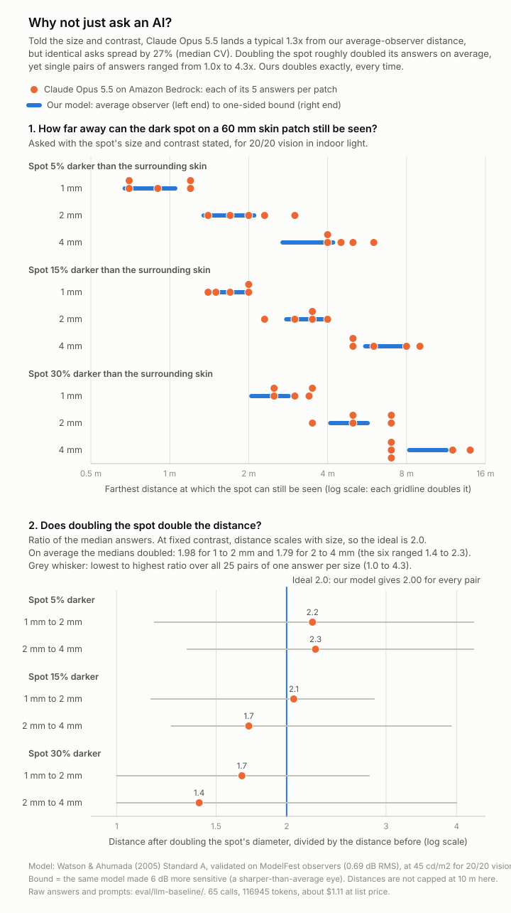

# Why not just ask an AI?

A head-to-head between a frontier vision LLM and our visibility model, run on 65 real calls.
The LLM is **Claude Opus 5.5 on Amazon Bedrock** (`global.anthropic.claude-opus-5-5`, Converse API).



## Short version

Claude's general sense of the physics is good. Told a spot's size and contrast, its median answer landed inside our
average-observer-to-bound range on 6 of 9 patches and within 1.15x of it on the other 3. We did not expect that, and it
is the honest starting point: **"an LLM gives nonsense" is not what we found.**

What it cannot do is give a number you can build on:

- **It is a fresh estimate on every ask.** Five identical asks about one patch differ by 16% to 36% (CV, median 27%),
  and the highest of the five is 1.4x to 2.1x the lowest. That run-to-run range is as wide as our whole
  average-observer-to-bound band (1.4x to 1.6x). Ours has zero spread.
- **It does not obey the size law.** At fixed contrast, distance must double when the spot doubles. Per-ask ratios run
  from 1.0x to 4.3x, and at 30% contrast the median answers rise by only 1.7x and 1.4x.
- **On real faces the numbers are not tied to the face.** It gave the same median for pores (0.8 m) on all four faces,
  where our measured pore counts in view at 1.5 m run from 22% to 53%, and it answered "null" for breakouts on three
  faces where YouCam found 18, 5 and 3 of them. It also gives one number per concern, with no count and no location.
- **It measures nothing.** In Test B we handed it the size and contrast. On a face it has to guess both from pixels.

Not shown: that the LLM is wrong on real faces. There is no ground truth for those, and Test A only measures
consistency and sensitivity to the individual face.

## Setup

- 65 calls: 20 for Test A, 45 for Test B, 0 retries. Budget was 80 calls and an estimated $5.
- Each call is independent: one user message with one image and one text block, no history.
- `maxTokens: 4000` and nothing else. No temperature, topP, thinking or budget settings (this model rejects sampling
  parameters and always thinks). The reply is JSON in plain text, parsed leniently (`stats.ts`).
- Exact prompts: [prompts.md](prompts.md). Every raw reply: [results/raw/](results/raw/). All numbers below are in
  [results/summary.json](results/summary.json).
- **Tokens and cost:** 76,790 input and 40,155 output tokens (Test A: 46,100 in, 7,825 out; Test B: 30,690 in, 32,330
  out). At the list price we assumed, $4 per million input and $20 per million output, that is about **$1.11**
  ($0.34 for Test A, $0.77 for Test B). Bedrock billing may differ. No YouCam units were used.

## Test A: real-looking faces (20 calls)

The four recorded persona photos (`fixtures/youcam/{p1a,p2b,p3a,p5a}/input.jpg`, synthetic faces), five independent asks
each, with the interpupillary distance given as about 63 mm. The question asks for the **farthest** distance at which each
concern could still be seen, so the matching column of ours is the bound on the farthest target (`maxDistanceM`). We
also show `medianDistanceM` and how many of the face's targets are still in view at 1.5 m. Our numbers come from the
same code path as `scripts/dev/pipeline.ts`; "10+" is our 10 m contract cap.

| Face | Concern | Claude: median (min to max) | CV | Ours: max / median (m) | Ours: in view at 1.5 m |
|---|---|---|---|---|---|
| p1a | pores | 0.8 (0.6 to 1) | 22% | 4.07 / 1.26 | 150 of 450 |
| p1a | dark spots | 1.5 (1 to 1.5) | 17% | 10+ / 3.26 | 62 of 64 |
| p1a | fine lines | 0.6 (0.5 to 0.6), null in 2 of 5 | 10% | 10+ / 2.22 | 69 of 93 |
| p1a | under-eye shadows | 4 (3 to 5) | 20% | 10+ / 10+ | 2 of 2 |
| p1a | redness | 3 (2.5 to 4) | 20% | 2.9 / 0.12 | 1 of 5 |
| p1a | breakouts | 3 (3 to 4) | 14% | 9.1 / 1.61 | 24 of 40 |
| p2b | pores | 0.8 (0.6 to 1) | 25% | 4.22 / 1.55 | 342 of 649 |
| p2b | dark spots | 4 (3.5 to 4) | 7% | 10+ / 4.55 | 88 of 89 |
| p2b | fine lines | 1.5 (1.5 to 2) | 14% | 10+ / 2.62 | 145 of 188 |
| p2b | under-eye shadows | 6 (5 to 7) | 12% | 10+ / 10+ | 2 of 2 |
| p2b | redness | null in 5 of 5 runs | - | no redness found | - |
| p2b | breakouts | null in 5 of 5 runs | - | 5.13 / 1.65 | 13 of 18 |
| p3a | pores | 0.8 (0.6 to 1) | 22% | 3.15 / 1.33 | 81 of 221 |
| p3a | dark spots | 6 (5 to 6) | 8% | 10+ / 3.2 | 187 of 194 |
| p3a | fine lines | 2 (1.5 to 2.5) | 20% | 10+ / 2.43 | 151 of 207 |
| p3a | under-eye shadows | 3.5 (3 to 3.5) | 7% | 10+ / 10+ | 3 of 3 |
| p3a | redness | 9 (6 to 10) | 19% | 10+ / 5.05 | 2 of 4 |
| p3a | breakouts | null in 5 of 5 runs | - | 3.24 / 2.11 | 5 of 5 |
| p5a | pores | 0.8 (0.6 to 0.8) | 15% | 3.11 / 1.15 | 55 of 250 |
| p5a | dark spots | 2.5 (2.5 to 3) | 10% | 7.07 / 3.12 | 50 of 53 |
| p5a | fine lines | 1 (1 to 1) | 0% | 9.79 / 1.82 | 63 of 107 |
| p5a | under-eye shadows | 4 (3 to 5) | 18% | 10+ / 10+ | 2 of 2 |
| p5a | redness | null in 5 of 5 runs | - | no redness found | - |
| p5a | breakouts | null in 5 of 5 runs | - | 2.46 / 1.76 | 3 of 3 |

Reading it:

- **Consistency is better than we expected, and still not zero.** Over the 19 cells with a spread, the median CV is 15%
  and the median highest-over-lowest is 1.4x (worst 1.7x). One cell flips on whether the concern exists at all: p1a
  fine lines is a number in 3 runs and null in 2.
- **Ours is identical on every run.** Computing all four faces twice in one process gives byte-identical results (SHA-256
  `528cec5a...` in `summary.json`), and `scripts/dev/pipeline.ts p1a p2b p3a p5a` run twice gave identical output
  (SHA-256 `dc36539f...`). The model has no randomness; the same photo gives the same numbers.
- **The LLM's numbers barely move with the face.** Pores are 0.8 m on every face. Our pore counts in view at 1.5 m are
  33%, 53%, 37% and 22% of what was found. Under-eye shadows are 3.5 to 6 m for Claude and past our 10 m cap for ours.
- **Breakouts: null on three of four faces** where YouCam located 18, 5 and 3 (visible from 5.1, 3.2 and 2.5 m at the
  most). Claude is looking at pixels with no mask to guide it.
- **These are not contradictions in every case.** Our `max` is a deliberately generous one-sided bound: "beyond this, not
  visible even to a sharp-eyed observer looking straight at it". A lower answer can be right for a typical viewer. With no
  ground truth for these faces, the self-test (walk back until a dot vanishes) is how our numbers get checked, not this table.
- What Claude cannot return is the thing the product shows: *which* targets, *where*, and *how many* at a given distance.

## Test B: physics on synthetic patches (45 calls)

Nine 60 x 60 mm patches at 10 px/mm: uniform skin tone sRGB (208, 154, 124), a centred dark disk of 1, 2 or 4 mm and
Weber contrast 5%, 15% or 30%, and a printed millimetre ruler along the bottom edge (`patches.ts`, copies in
[results/patches/](results/patches/)). The contrast is Weber contrast in **linear light**, and the 8-bit sRGB colour is
chosen so the realised contrast is within 0.01 percentage points of the target. Claude was told the size and the
contrast in words, "told everything our model knows", five asks per patch.

**Ground truth.** The published Watson & Ahumada (2005) Standard A model of human contrast detection, validated against
ModelFest observers (0.69 dB RMS over 41 analytic stimuli, `eval/results/modelfest.json`), through `lib/vision` with
`DEFAULT_VIEWING` (45 cd/m2, 20/20). *Average observer* is `marginDb` 0; *bound* is `marginDb` 6 with the one-sided
luminance factor. Two caveats: this is a model of human vision validated on lab stimuli, not a measurement of people
looking at these exact patches, and the step from ModelFest's 30 cd/m2 to indoor 45 cd/m2 is an unverified heuristic in
the model (`luminanceGain` in `lib/vision/castle.ts`). The distances here are not capped at 10 m.

| Spot | Our model: average observer to bound (m) | Claude: median (min to max), m | CV | Median over average-observer value | Answers inside our range |
|---|---|---|---|---|---|
| 1 mm, 5% | 0.66 to 1.07 | 0.9 (0.7 to 1.2) | 27% | 1.36x | 3 of 5 |
| 2 mm, 5% | 1.32 to 2.14 | 2 (1.4 to 3) | 30% | 1.51x | 3 of 5 |
| 4 mm, 5% | 2.64 to 4.28 | 4.5 (4 to 6) | 18% | 1.7x | 2 of 5 |
| 1 mm, 15% | 1.37 to 2.01 | 1.7 (1.4 to 2) | 16% | 1.25x | 5 of 5 |
| 2 mm, 15% | 2.73 to 4.01 | 3.5 (2.3 to 4) | 20% | 1.28x | 4 of 5 |
| 4 mm, 15% | 5.46 to 8.03 | 6 (5 to 9) | 28% | 1.1x | 2 of 5 |
| 1 mm, 30% | 2.01 to 2.9 | 3 (2.5 to 3.5) | 16% | 1.49x | 2 of 5 |
| 2 mm, 30% | 4.02 to 5.79 | 5 (3.5 to 7) | 27% | 1.24x | 2 of 5 |
| 4 mm, 30% | 8.04 to 11.59 | 7 (7 to 14) | 36% | 0.87x | 0 of 5 |

**Error against the model.** Taking the median answer per patch, Claude is off the average-observer distance by a
geometric mean of **1.33x** (worst 1.70x, at 4 mm and 5%); counting every one of the 45 answers it is 1.39x. Eight of nine
medians are above the average-observer value, so it leans toward "visible from farther". 23 of 45 answers (51%) fall
inside our range and the other 22 miss it by up to 1.4x. By the medians alone this is a decent estimate. By any single
ask it is a coin flip on being inside the range.

**The size law.** Visibility depends only on the angle a feature subtends, so at fixed contrast the farthest distance
scales exactly with physical size. Our model gives 2.0000 for every doubling by construction (a test in
`llm-baseline.test.ts` checks it).

| Contrast | Doubling | Our model | Claude: ratio of medians | Claude: lowest to highest over 25 answer pairs |
|---|---|---|---|---|
| 5% | 1 to 2 mm | 2 | 2.22 | 1.17 to 4.29 |
| 5% | 2 to 4 mm | 2 | 2.25 | 1.33 to 4.29 |
| 15% | 1 to 2 mm | 2 | 2.06 | 1.15 to 2.86 |
| 15% | 2 to 4 mm | 2 | 1.71 | 1.25 to 3.91 |
| 30% | 1 to 2 mm | 2 | 1.67 | 1.00 to 2.80 |
| 30% | 2 to 4 mm | 2 | 1.40 | 1.00 to 4.00 |

Averaged over the three contrasts the ratio of medians is 1.98 for 1 to 2 mm and 1.79 for 2 to 4 mm, so the *average*
is not far from 2. It is not stable: no pair of answers is guaranteed to obey the law, and at 30% contrast the
medians clearly do not.

**Why.** Claude's own short reasoning (stored in each raw file) states the right recipe: a spot is visible when it
subtends at least some threshold angle for that contrast, so distance is size divided by that angle (28 of the 45 replies
cite Ricco's law, 31 cite Blackwell thresholds, 44 give an angle in arcminutes and 44 describe the result as an estimate or approximation). Any
single threshold angle per contrast would give an exact doubling. But the angle is recalled afresh each time: for the
4 mm, 30% spot it used about 2 arcmin in one ask (answer 7 m) and about 1.15 arcmin in another (12 m). That is the
spread, and it is where the law breaks.

## What this does and does not show

- **One model, one prompt wording, five asks per item.** A different prompt, or the median of many asks, would shrink the
  noise by roughly the square root of the number of asks. That costs N calls per number, and still gives no per-feature
  counts. We did not try it.
- **Test B is the LLM's best case:** an isolated disk, size and contrast supplied, one concern. It still misses the
  range on half its answers.
- **Our side is a model too.** Standard A is validated on ModelFest, and the app's claim is a one-sided bound, not a
  prediction for any one person. The luminance step above is unverified. What our model offers is not extra truth about
  humans, it is that it is *lawful, repeatable and inspectable*: every number traces to a measured size, a measured
  contrast and a published curve, and the walk-back test lets anyone check it with their own eyes.
- **The LLM's general advice is often sensible**, such as "pores usually are not visible at conversation distance".
  That is a fine thing to read. It is not a per-face, per-feature measurement.

## Reproduce

```
npm run spike -- eval/llm-baseline/run.ts              # calls the model for every uncached item (needs CLAUDE_AWS_* in .env), then rewrites results/
npx tsx eval/llm-baseline/run.ts --offline             # no network: rebuild summary.json, chart.svg, patches/ and prompts.md from the cache
npx tsx eval/llm-baseline/run.ts --prompts             # write prompts.md only
```

`run.ts` never calls a cached item again (one file per call under `results/raw/<test>/<item>/run<N>.a<K>.json`),
holds the 80-call and $5 limits before every call, and allows at most one retry per run (none were needed).

| File | What |
|---|---|
| `run.ts` | the driver: tasks, budget guard, cache |
| `bedrock.ts` | one cached Converse call |
| `patches.ts` | patch generation and the sRGB contrast maths |
| `prompts.ts`, `prompts.md` | the exact prompts (the markdown is generated) |
| `answers.ts`, `stats.ts` | reply parsing and the statistics |
| `ours.ts` | our numbers for the faces and the disk ground truth |
| `summary.ts`, `chart.ts` | `results/summary.json` and `results/chart.svg` |
| `llm-baseline.test.ts` | tests: disk geometry in pixels, contrast maths, the size law, reply parsing |
